
<strong>简体中文</strong> | <a href="README_en.md">English</a>

<h1 align="center">EduPilot · AI 学习向导</h1>

<strong>把教材、练习与知识关联串起来，让每一步学习都有迹可循。</strong>

导入资料成课，用真实运行反馈练习，用个人图谱连接知识，用活动记录掌握学习过程。 Windows / macOS 原生桌面 App · 中英文界面 · 接入自己的模型 API Key

  
  
  
  

<a href="#download">下载 v3</a> · <a href="#whats-new">v3 新功能</a> · <a href="#workspace">基础界面</a> · <a href="#features">教材与学习</a> · <a href="#demo">学习演示</a> · <a href="#api-keys">接入模型</a> · <a href="#faq">常见问题</a>

## 从教材出发，练出自己的理解

EduPilot 是在自己电脑上使用的 AI 学习工作台。导入中英文教材，按章节完成预习、学习与复习；遇到难点可以追问、查看教材依据，再通过练习检验理解。课程、对话和学习记录留在本机，在线 AI 能力使用你选择的模型服务。

**v3 把练习、知识关联和过程控制接进同一条学习路径。** 练习失败时能看到具体输入和结果；完成订正后可以用新题继续验证。知识图谱连接课程、章节与知识点，活动记录说明本轮执行到了哪一步，课程管理让自己的资料库更容易维护。

| 你想做什么 | v3 的入口与能力 |
| --- | --- |
| 看清代码哪里错、换题后能否独立完成 | [诊断练习](#diagnostic-practice)：真实执行反馈、分级提示、订正与新题首答分别记录 |
| 把学过和正在学的内容串起来 | [个人知识图谱](#knowledge-graph)：来源、学习证据、个人笔记和跨课程关联 |
| 知道 AI 正在做什么，并控制本轮任务 | [活动记录](#run-activity)：执行状态、调用与用量、取消和符合条件的继续执行 |
| 整理不再需要或名称不清楚的课程 | [课程管理](#course-management)：搜索、打开、改名、单独删除与清理重试 |

教材检索增强（RAG）、多角色讲解、错题本、学习报告和“预习 → 学习 → 复习”流程继续保留。**适合自主学习、课程复习、整理个人学习资料，以及动手学习 Python。**

## 下载 v3.0.0，开始你的第一节课

下载原生桌面 App，双击图标即可学习，无需管理服务器或另外安装 Node.js / Python。应用使用独立窗口，关闭窗口后驻留托盘，后台异常会自动尝试恢复。

| 你的电脑 | 下载 |
| --- | --- |
| Windows x64 | [下载 Setup.exe](https://github.com/2092372408-pixel/EduPilot/releases/download/v3.0.0/EduPilot-3.0.0-Windows-x64-Setup.exe) |
| Mac · Apple Silicon（M 系列芯片） | [下载 Apple Silicon DMG](https://github.com/2092372408-pixel/EduPilot/releases/download/v3.0.0/EduPilot-3.0.0-macOS-arm64.dmg) |
| Mac · Intel 芯片 | [下载 Intel DMG](https://github.com/2092372408-pixel/EduPilot/releases/download/v3.0.0/EduPilot-3.0.0-macOS-x64.dmg) |

1. **下载**适合自己电脑的安装包。Mac M 系列芯片请选择 Apple Silicon。
2. **双击安装**：Windows 运行 `Setup.exe`，按提示安装；macOS 打开 `.dmg`，把 EduPilot 拖入 Applications。
3. **接入模型，开始学习**：在设置中选择供应商、模型并配置自己的 API Key，测试连接后保存。随后可学习内置 Python 课程，或上传教材创建课程。

以后从 Windows 桌面或 Mac 启动台打开 **EduPilot** 即可。关闭窗口会隐藏到托盘（Mac 菜单栏），后台继续运行；完全退出请从菜单选择 **退出 EduPilot**。学习记录保存在本机，下次打开接着学。

首次打开有按钮指向式教程，带你认识选课、上传、提问、错题本和报告。可以跳过，也可以从顶部 **教程** 重新查看。当前安装包未签名，Mac 包也未公证，系统可能提示来源或阻止打开；请核对 [Release 页面](https://github.com/2092372408-pixel/EduPilot/releases/tag/v3.0.0) 的附件与 SHA-256。旧版用户请先查看下方升级说明。

第一次用，也有人带你上手

新手引导高亮真实按钮，用箭头和旁边的说明带你完成第一步，可以随时跳过或重看。下图来自既有版本，展示基础引导流程。

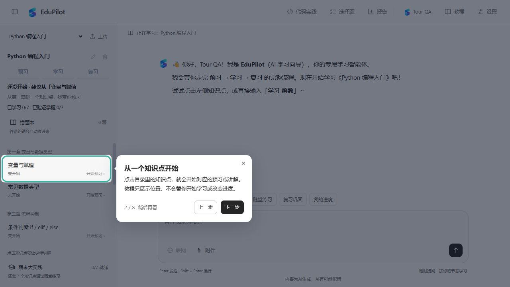

原生安装包自带应用运行环境、Python 和文档解析依赖。诊断练习的发题、判分和分级提示可直接使用，无需模型密钥；在线讨论和教材讲义生成需要自己的模型服务。首次使用语义检索需联网下载模型，下载不可用时回退关键词检索。更多使用方式见 [桌面启动与退出说明](docs/桌面启动与退出说明.md)。

### 从旧版升级

从应用菜单选择 **退出 EduPilot** 后再安装新版；关闭窗口只是隐藏到托盘。建议先备份整个用户数据目录：Windows 为 `%APPDATA%\EduPilot`，macOS 为 `~/Library/Application Support/EduPilot`。托盘菜单的 **打开学习数据文件夹** 打开的是其中的 `workspace/data`，向上两级可找到需要备份的目录。

使用同一系统用户安装 v3 会继续读取原有数据位置；课程、会话、模型配置和学习记录与程序文件分开保存。升级需手动下载安装包；旧版脚本包不会自动迁入桌面版。完整备份步骤与数据说明见 [升级指南](docs/桌面启动与退出说明.md#升级到-v300)。

## v3：让练习有依据，让学习能接着走

### 1. 诊断练习：看懂错误，再用新题验证

在内置 **Python 编程入门** 课程中打开 **诊断练习**。先提交一次尝试，比较失败输入、预期值与实际结果；按需要逐级查看提示，订正后再完成一道未见变式。练习页与报告分别展示订正记录和新题首次通过记录，返回学习对话后，导师也能参考近期练习情况。

当前提供三个主题：

| 主题 | 练习重点 |
| --- | --- |
| 分支与奇偶判断 | 根据输入选择分支，处理零与负数 |
| 循环边界与求和 | 逐项累加，检查闭区间端点和空区间 |
| 函数返回与输入变化 | 根据不同输入计算结果，区分返回值与打印输出 |

判分依据是代码的实际运行结果和题面明确要求的实现约束。每道变式在发出前都会运行参考解与典型错解进行检查；AI 讨论不改变客观判分。发题、判分与分级提示无需模型 API Key，v3 桌面安装包已包含所需 Python 环境；**讨论这道题** 需要已配置的模型服务。诊断验证仅支持内置课程的这三个主题，暂不支持上传课程。

**帮助记录说明：** 系统区分“明确未使用应用内帮助”“已使用帮助”和“帮助状态未知”。从当前题目提交讨论问题时，系统接收求助后先保存帮助记录，再请求模型；即使回复失败，已保存的求助记录也会保留。同一课程中未绑定题目的聊天，会把原本未记录帮助的正在作答题目保守地标为帮助状态未知。只有未见新题首次验证通过、且应用内记录明确无帮助，才记为一次独立验证；它不判断外部帮助，不证明长期掌握，也不替代正式复习测验。历史记录不全时不会补造独立证据。

已提交的代码、提示和结果在本机保存，刷新后可以继续；重复请求不会重复计分。代码在本机教学执行器中运行，带有静态预检与执行限制，适用于个人本地练习，不作为公开多用户代码执行服务。

### 2. 个人知识图谱：把知识连起来，也保留依据

从侧栏打开 **知识图谱**，在图形或列表中浏览课程、章节和知识点。搜索名称，按课程和学习状态筛选；选择节点后查看来源、已有作答与复习记录、建议先学内容，保存笔记，再跳回相应课程或支持的诊断练习。

- **看清关联从哪里来**：课程结构、内置学习路径建议、用户添加的关系分别标明来源。
- **由自己确认跨课程关联**：同名知识点先显示为待确认候选，不自动合并，也不凭标题或章节顺序生成先修关系。
- **建立个人理解**：添加“相关”“建议先学”“应用于”关系；形成循环的先修关系会被拒绝并提示修改。
- **学习记录与个人整理分开**：笔记和连线不会改变成绩；已有练习、复习和独立验证记录作为不同证据展示。一次最多展示 600 个知识点，超出时明确提示；筛选针对本次已加载内容。

### 3. 活动记录：看得见进展，也能控制本轮执行

展开学习对话或诊断练习中的 **活动记录**，查看执行状态、已确认步骤、模型与工具调用次数，以及已结算和预留的 Token 用量。执行中可以选择 **取消本轮**；符合条件的中断、失败或取消任务会显示 **继续执行**。

继续执行沿用原有预算与时限，并复用已确认的写入；学习状态或模型配置发生变化、额度不足、课程被删除或重置时，不能把旧任务直接接回。供应商未返回用量的调用保留预留额度，不算作零消耗。活动记录用于理解与控制执行过程，实际费用以所选服务商账单为准。

### 4. 课程管理：把自己的学习资料整理好

在课程选择器中打开 **管理课程**，搜索、打开、改名或删除上传课程，无需先切换到那门课。内置 Python 课程受保护，不提供改名或删除操作。

删除前会明确确认，且无法在应用内撤销。它会清理当前安装中各学习档案属于这门课程的素材、附件、会话、学习记录、课程记忆、图谱笔记与关联、活动记录；其他课程和跨课程用户画像保留。被删除的课程立即停用，未完成的旧任务不能将其重新写回。若某些文件或记录暂时无法清理，**管理课程** 会保留 **重试清理** 入口。

## 工作台与基础学习流程

以下截图与动图来自既有版本，展示教材导入、对话、练习和报告等基础流程；并非 v3 新功能实拍。v3 的诊断练习、知识图谱、活动记录和课程管理入口以当前应用为准。

左侧选择课程与知识点，右侧跟随学伴提问、理解和练习。配置模型后，可以学习内置 Python 课程，也可以导入自己的教材。课程目录下方支持新建和切换历史对话；聊天上下文按课程和会话隔离，进度与成绩归属各自课程，同一用户的长期记忆在所有课程间统一检索并保留来源。编程实践、报告、导入和考试均在应用内切换，返回后保留原有工作状态。

看看内置课程与专注对话布局

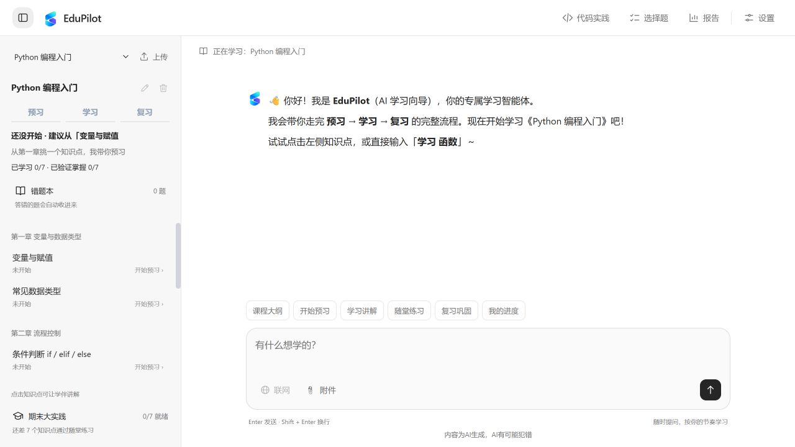

收起侧栏，为讲解和追问留出更大的空间。

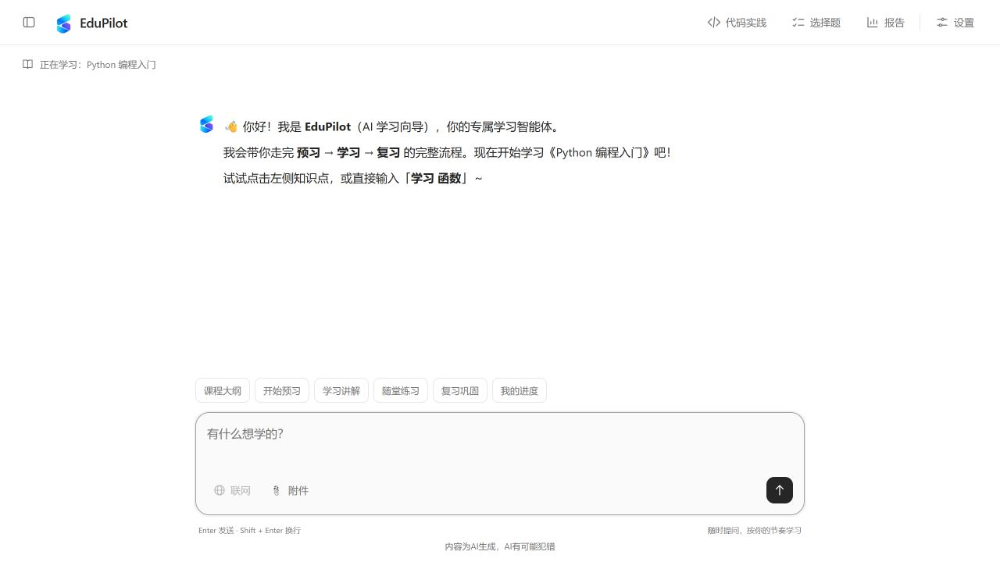

## 从一份教材，到一次完整学习

导入资料 → 自动成课 → 预习检测 → 学习与练习 → 查看学习报告。以下既有版本动图展示这条基础学习流程的关键步骤。

展开查看真实界面的学习演示

## 教材、问答与完整学习流程

### 1. 上传教材，自动组织成一门可以学的课

导入中英文 PDF、Word（.docx）、PowerPoint（.pptx）、Markdown、TXT 或 JSON，EduPilot 在本地整理章节与正文，完成后即可开始学习；讲解和选择题在需要时由所选模型生成。

从资料到课程，整个过程都可以看见：

- **保留章节结构**：优先识别原有标题，也支持“第一章”“Chapter 1”“1.1”等中英文标题；检索内容按识别出的章、节切分，保留出处。
- **看得见处理进度**：展示解析、分章切块和保存等阶段，并显示已用时间。
- **围绕教材生成**：学习和练习时读取对应章节原文；题目按需生成并保存，模型输出仍需用户结合教材核对。
- **逐步完善自己的课**：可以追加或更新资料；更新失败时保留之前可用的课程。

看看教材导入与处理进度

侧栏点击 **上传**，创建新课程或追加到已有课程，选择资料后开始处理。完成后回到主页，就能选择生成的章节与知识点。

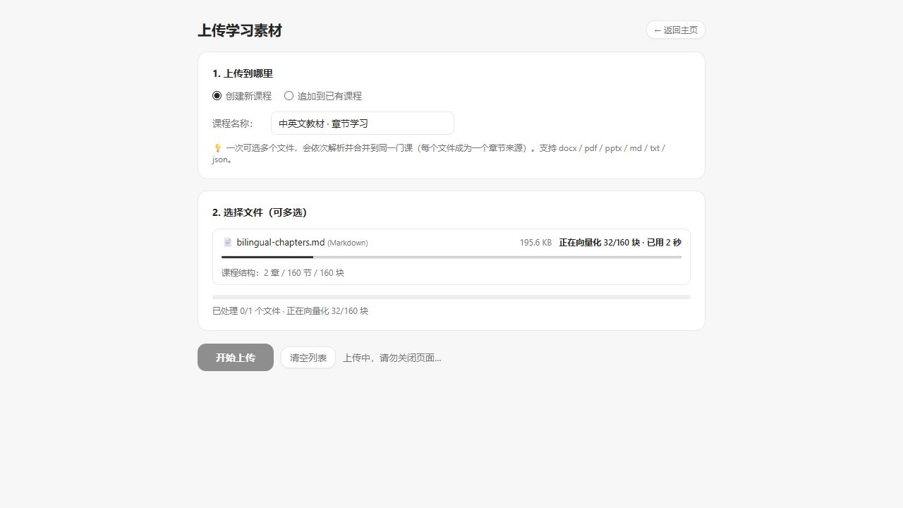

### 2. 预习 → 学习 → 复习，每一步都有下一步

先了解章节内容，再通过预习自测发现还不熟悉的地方，随后跟随讲解、练习和复习巩固知识。遇到难点可以直接说“换个例子解释”或“我卡在这一步”，不用退出当前学习过程。

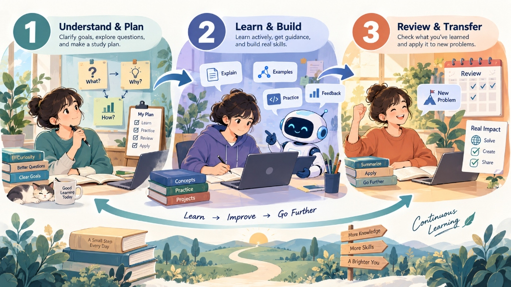

| 阶段 | 怎么学 | 如何继续 |
| --- | --- | --- |
| 预习 | 看知识地图，回答引导问题，完成预习自测 | 答完自测后进入学习，允许在预习中犯错 |
| 学习 | 看讲解、示例与易错点，完成随堂练习 | 随堂检测全对后进入复习 |
| 复习 | 回顾知识、重练薄弱点，完成复习测验 | 复习测验全对后记录为已掌握，并安排后续复习 |

每个知识点分别记录学习阶段。“看过了”和“通过检测了”分别呈现，帮助你把时间放在还需要练习的内容上。

在对话里完成学习与练习

题卡就在对话中，选择答案即可查看反馈与解释，选择题答案由服务端按题库核对。正式阶段检测用于推进进度；额外练习与错题重练则帮助巩固理解。

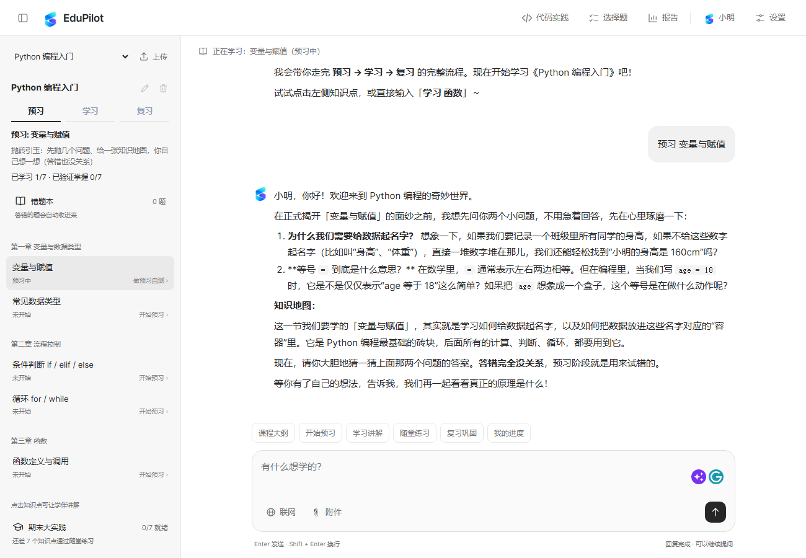

### 3. 记住你的目标，让下一次学习接得上

告诉学伴你的学习目标、基础和偏好，例如“我刚开始学 Python，希望多用生活中的例子”。这些有用的信息可以成为后续讲解的参考，不必每次从头介绍自己。

课程进度、对话和练习记录会保留在本机。学习目标与偏好可以跨课程使用，各门课程的进度和卡点分别记录；下次打开时，继续之前的课程，让一次次提问与练习逐渐积累成自己的学习路径。

学伴怎样连接前后的学习

当前目标和课程进度作为讲解的参考，过去的对话保留为可查找的记录，值得长期保留的信息按需要取用。较早的对话会形成摘要，发送给模型的上下文也有长度限制，控制长对话的输入量与使用费用。

长期记忆侧重明确的学习目标、稳定偏好和反复出现的困难。你可以在对话中说明新的目标或更正偏好，让后续学习适应变化。

### 4. 错题、复习与报告，帮你找到该花力气的地方

答错的题会进入错题本，可以查看自己的答案、正确答案与解析，再次练习。学习报告把课程进度、待完成检测和复习安排放在一起，方便决定接下来学什么。

主页、错题本和报告连接同一条学习路径：从报告找到待完成的检测，回到课程继续学；遇到需要巩固的知识点，再回来复习。学完内置 Python 课程、满足解锁条件后，还可以挑战综合测验，把分散的知识点连起来使用。

看看错题本与学习报告

从侧栏打开 **错题本**，查看答题记录并选择重练。

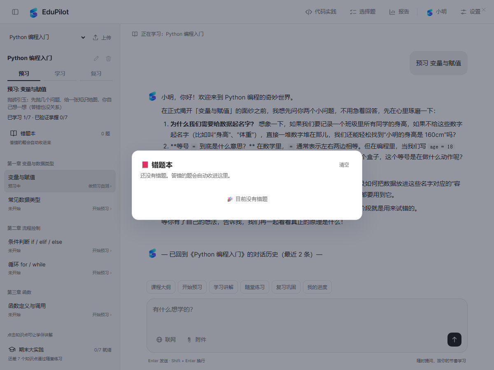

从侧栏打开 **报告**，查看学习覆盖、已验证掌握、下一步与复习清单。

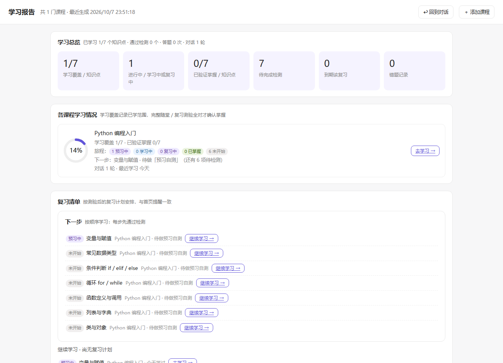

### 5. 既能跟着学，也能随时问、动手练

课程规划、预习、学习和复习各有专门的学伴角色配合；课程之外的问题，由通用教育学伴帮助解释、举例和提供学习建议。你可以沿着章节前进，也可以暂停下来探究一个感兴趣的问题。

- **带着材料提问**：把图片或文档附在问题旁，结合内容一起讨论；图片提问请选择支持图片输入的模型。
- **按需联网查资料**：通过输入框旁的联网开关，调用当前供应商支持的原生搜索。使用现有模型密钥，支持情况取决于模型与服务区域，来源可点击展开。
- **Python 动手实践**：在代码实践区写代码、运行、提交并查看反馈。做题助手能结合当前题目和运行结果提供提示。

看看附件提问、选择题与 Python 实践

在输入框旁添加附件，带着具体材料追问。

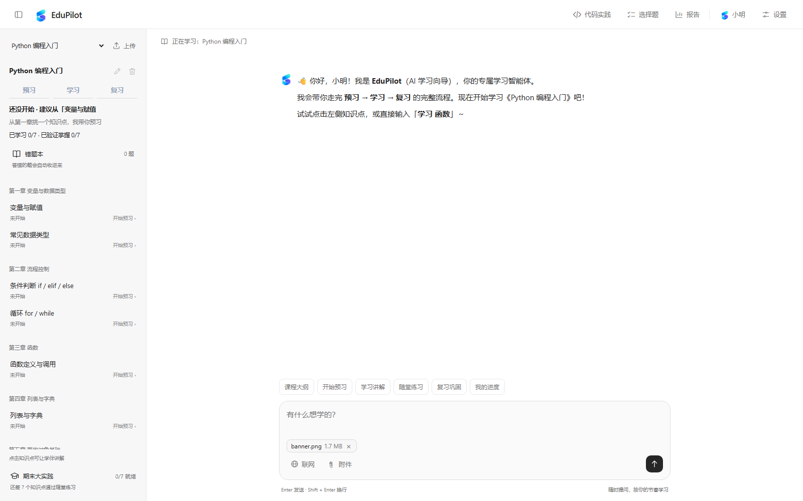

内置 Python 课程提供独立的选择题与代码实践区；导入课程的配套选择题在学习对话中完成。

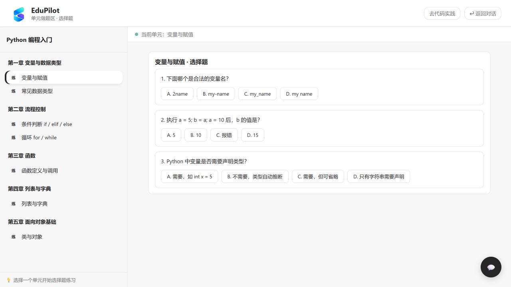

先运行代码查看输出，再提交获取判分反馈；卡住时打开做题助手。

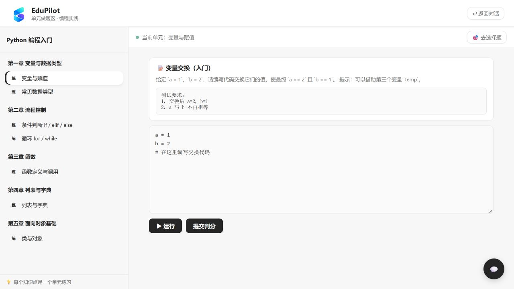

### 6. 在自己的电脑上学习，用顺手的模型与语言

支持 Windows 和 macOS，安装后双击桌面图标即可打开。原生版关闭窗口后驻留托盘，从菜单选择“退出 EduPilot”才会停止后台；浏览器兼容包关闭最后一个页面后自动停服。课程、对话、错题和学习记录保存在本机，下次打开接着学。

界面支持中文和英文，也可以调整字号、收起侧栏。模型由你选择：接入 DeepSeek、Qwen、OpenAI、GLM、Kimi 等服务，或使用兼容接口的其他服务，让学伴适应自己的使用习惯。

文档解析在本机完成；接入在线模型或联网搜索时，相关问题、教材片段或附件会发送到所选服务商。你可以根据需要决定使用哪些能力。

看看语言与显示设置

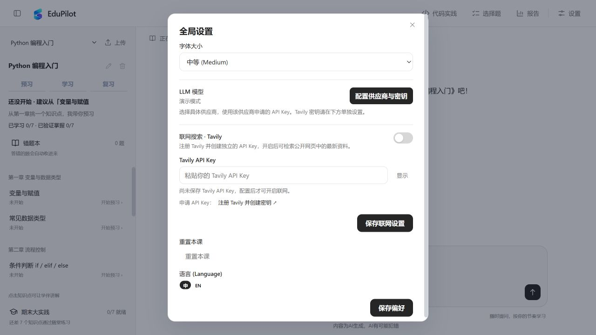

## 接入你喜欢的模型

打开 **设置 → LLM 模型 → 配置供应商与密钥**，选择供应商，填入 API Key，选择模型并保存。开放问答、自己的教材讲义与题目生成使用所选模型，费用由服务商收取。

支持 DeepSeek、Qwen、OpenAI、GLM、Kimi 等服务及兼容接口。原生联网支持情况会在设置中显示，通过输入框旁的开关控制，无需额外的搜索密钥。不同模型的搜索能力与费用以供应商为准，未确认支持时不会冒充联网回答。

可以先 **测试连接**，再保存启用；列表没有需要的模型时，填写服务商提供的自定义 Model ID。发送图片前，选择支持图片输入的模型并测试图片能力。

看看模型配置界面

在界面中选择供应商、查看模型能力提示并填写密钥，无需手动修改配置文件。

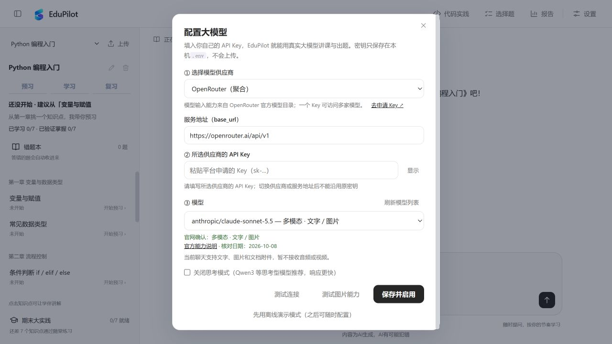

查看各供应商的官方密钥入口

| 供应商 | 官方入口 |
| --- | --- |
| DeepSeek | [创建 API Key](https://platform.deepseek.com/api_keys) |
| 阿里云百炼 · Qwen | [控制台](https://bailian.console.aliyun.com/) |
| OpenAI | [创建 API Key](https://platform.openai.com/api-keys) |
| 智谱 · GLM | [创建 API Key](https://open.bigmodel.cn/usercenter/apikeys) |
| Moonshot · Kimi | [创建 API Key](https://platform.kimi.com/console/api-keys) |
| 硅基流动 | [创建 API Key](https://cloud.siliconflow.cn/account/ak) |
| 火山方舟 · 豆包 | [控制台](https://console.volcengine.com/ark) |
| OpenRouter | [创建 API Key](https://openrouter.ai/keys) |

## 你可能想知道

**没有 API Key，可以先用吗？**

可以。无需密钥即可浏览已有课程与记录、整理个人知识图谱，并完成三个内置主题的诊断发题、判分和分级提示。AI 对话、题目讨论，以及上传教材的讲义和选择题生成需要模型供应商、模型和 API Key；请求失败会明确提示，不会切换到演示回答。支持原生联网的模型使用同一个供应商密钥。

**中英文教材都支持吗？**

支持中英文内容及界面。PDF 请使用可提取文字的版本，扫描件需要先转成文字。

**为什么答对了，进度还没有变成“已掌握”？**

各阶段检测分别记录。完成预习自测解锁学习，随堂检测全对解锁复习，复习测验全对才记录为已掌握。诊断练习中的订正或新题独立验证、额外练习、错题重练都不代替正式阶段检测；“已掌握”表示通过了对应复习测验，并非长期学习效果保证。

**资料和学习记录存在哪里？**

教材解析在本机完成，课程、对话和学习记录保存在自己的电脑上。使用在线模型或联网功能时，相关问题、教材片段或附件会发送到你选择的服务商。

**需要额外安装环境吗？**

原生安装包自带应用运行环境、Python 和文档解析依赖。可选的本地语义检索首次使用需联网下载模型，下载不可用时使用关键词检索。旧版浏览器兼容包的 Python 实践仍需要额外安装 Python。

**教材导入需要多久？可以关掉页面吗？**

导入耗时取决于文件内容和本机性能。解析、分章和索引在本机进行；学习与出题时才调用所选模型。页面显示当前处理阶段，更新失败时保留之前可用的版本。扫描件和复杂图表可能需要先做 OCR 或核对原文。

**关掉网页就退出了吗？刷新会不会退出？**

原生版关闭窗口会隐藏到托盘，后台继续运行；点击托盘图标或再次打开应用即可返回。完全退出请从菜单选择“退出 EduPilot”。旧版浏览器兼容包关闭最后一个页面约 15 秒后停服。刷新不会主动中断后台。

**升级会保留之前的学习吗？**

原生版在同一系统用户的数据目录中继续读取配置、课程和学习记录。先完全退出并备份整个用户数据目录，再安装新版；没有应用内自动升级流程。旧版脚本包的数据仍在旧目录，不会自动迁入原生版。详见 [升级指南](docs/桌面启动与退出说明.md#升级到-v300)。

## 我们的初心

我们希望教育能够更科学、更流程化，也真正把学习的主动权交还给每一个人。科学化、流程化并不意味着把所有人放进同一个模板，而是让目标、探索、反馈和复习都有迹可循。学生不必只等待老师安排下一步，可以按照自己的兴趣主动提问、尝试、回顾，再决定要走向哪里。

学习也不该是一段段互不相连的台阶。它是一条贯穿一生的连续路径：过去的理解会成为今天的起点，今天的困惑也会为明天留下线索。EduPilot 希望用 AI 记录这条路径，让每一次提问、练习、犯错和进步都成为下一次学习可以继续利用的经验。

在 AI 快速发展的今天，学习速度与学习效率越来越重要。我们希望帮助更多人更高效、更连贯地学习，同时保留探索的自由，最终能够学自己真正想学的，并去做自己真正想做的事。

> **学自己想学的，做自己想做的。你的每一步，都值得被记录。**

## 一起让学习更顺手

有使用建议、想学的课程或遇到问题，欢迎通过 [GitHub Issues](https://github.com/2092372408-pixel/EduPilot/issues) 或 [邮箱](mailto:qiuyanzihan2004@gmail.com) 告诉我们。

© 2026 **Qiu Yanzihan** · 个人与非商业使用请参阅 [使用许可](LICENSE)；商业合作请联系作者。第三方材料的条款见 [第三方许可说明](THIRD_PARTY_NOTICES.md)。
