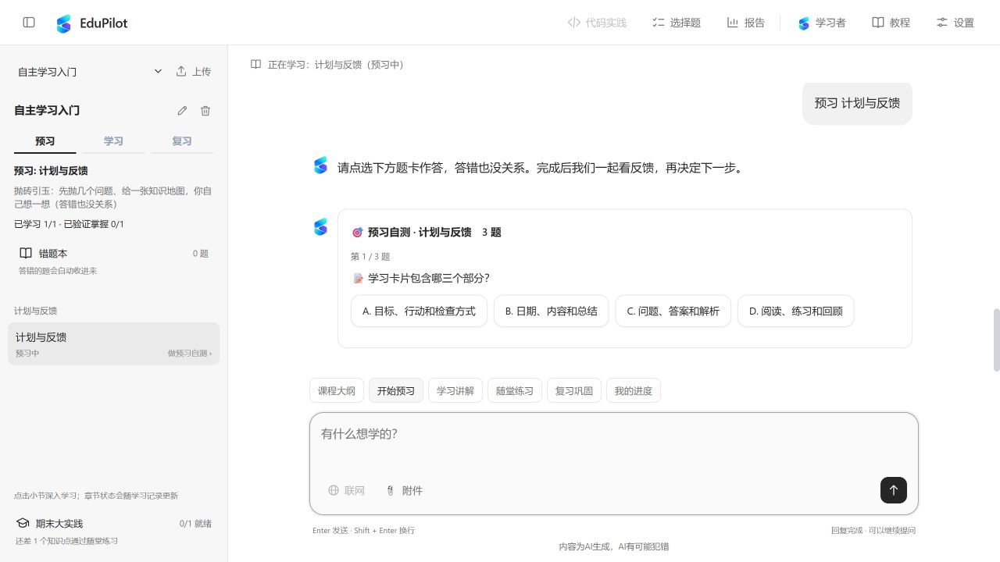
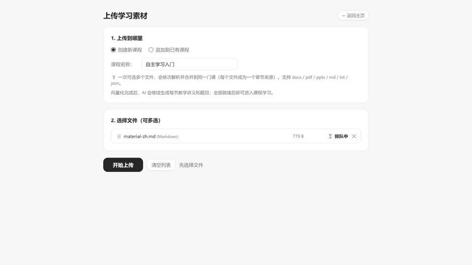

<p align="right"><strong>简体中文</strong> | <a href="README_en.md">English</a></p>

<p align="center"></p>

<h1 align="center">EduPilot · AI 学习向导</h1>

<p align="center"><strong>从一份教材开始，把理解、练习与知识连接起来。</strong></p>

<p align="center">Windows / macOS 桌面应用 · 中英文界面 · 自选 AI 模型</p>

EduPilot 是运行在自己电脑上的 AI 学习工作台。导入教材，跟随章节预习、学习与复习；通过代码练习检验理解，用个人知识图谱整理所学。课程、对话和学习记录保存在本机，AI 讲解与问答接入你选择的模型服务。

<p align="center"><a href="#download">下载安装</a> · <a href="#features">核心能力</a> · <a href="#quick-start">三步上手</a> · <a href="#workspace">学习演示</a> · <a href="#docs">文档</a></p>

<a id="download"></a>

## 下载 v2.0.0

| 平台 | 安装包 |
| --- | --- |
| Windows x64 | [下载 Setup.exe](https://github.com/2092372408-pixel/EduPilot/releases/download/v2.0.0/EduPilot-2.0.0-Windows-x64-Setup.exe) |
| macOS · Apple Silicon（M 系列） | [下载 Apple Silicon DMG](https://github.com/2092372408-pixel/EduPilot/releases/download/v2.0.0/EduPilot-2.0.0-macOS-arm64.dmg) |
| macOS · Intel | [下载 Intel DMG](https://github.com/2092372408-pixel/EduPilot/releases/download/v2.0.0/EduPilot-2.0.0-macOS-x64.dmg) |

安装包自带应用运行环境、Python 和文档解析依赖。安装与升级说明见 [桌面指南](docs/桌面启动与退出说明.md)，更多下载见 [Release 页面](https://github.com/2092372408-pixel/EduPilot/releases/tag/v2.0.0)。

<a id="features"></a>

## 核心能力

### 教材变课程

导入中英文 PDF、Word、PowerPoint、Markdown、TXT 或 JSON，按章节组织学习内容。结合教材检索（RAG）查看讲解、追问细节、完成配套选择题，让学习围绕自己的资料展开。

### 预习 → 学习 → 复习

多角色学伴配合规划、讲解与练习，每个知识点都有自己的学习进度。错题本、复习安排和学习报告帮助你找到下一步，学习目标与偏好也能延续到后续对话。

### Python 诊断练习

围绕内置 Python 课程的分支判断、循环求和、函数返回三个主题，运行代码并查看失败输入、预期结果与实际输出。按需获取分级提示，订正后再试一道新变式，分别记录订正和新题首次作答的结果。

### 个人知识图谱

连接课程、章节和知识点，查看内容来源与学习记录。搜索感兴趣的主题，添加笔记、确认跨课程关联，把分散的内容整理成自己的知识网络。

### 看得见的学习活动

查看本轮执行步骤、模型与工具调用、Token 用量。任务进行时可以取消，符合恢复条件时可以继续执行，让学习过程更容易掌握。

### 课程管理

搜索、打开、改名或单独删除上传课程，也可以追加和更新资料。在一个工作台维护自己的课程库，随时回到之前的学习进度与对话。

<a id="quick-start"></a>

## 三步上手

1. **安装并打开**：Windows 运行 `Setup.exe`；macOS 打开 DMG，将 EduPilot 拖入 Applications。
2. **接入模型**：在 **设置 → LLM 模型** 中选择供应商、填写 API Key，测试连接后保存。支持 DeepSeek、Qwen、OpenAI、GLM、Kimi 等服务及兼容接口。
3. **开始学习**：选择内置 **Python 编程入门**，或点击 **上传** 导入自己的教材。跟随章节学习，也可以从侧栏打开 **诊断练习**、**知识图谱**、**错题本** 和 **报告**。

图谱整理与内置诊断练习的发题、判分、分级提示可以直接使用。AI 对话和教材内容生成使用所选模型服务；相关问题、教材片段或附件会发送给该服务商。

首次打开可跟随引导认识界面，之后从顶部 **教程** 重新查看。完整操作说明见 [学习指南](docs/学生端说明书.md)。

<a id="workspace"></a>

## 学习工作台

左侧选择课程与知识点，右侧在对话中提问、练习、查看反馈。



<details>
<summary>观看教材学习演示</summary>

导入资料 → 生成课程 → 预习检测 → 学习与练习 → 查看报告。



</details>

<details>
<summary>开发者：从源码启动</summary>

准备 Node.js 22+ 和 Python 3，在终端执行：

```bash
git clone https://github.com/2092372408-pixel/EduPilot.git
cd EduPilot
npm ci --omit=dev
npm start
```

打开 [http://127.0.0.1:8787](http://127.0.0.1:8787)，在设置中接入模型。教材解析和本地语义检索还需安装 [Python 依赖](requirements-docker.txt)。

原生桌面开发与打包步骤见 [开发说明](docs/桌面启动与退出说明.md#源码与桌面开发)。

</details>

<a id="docs"></a>

## 文档与交流

- [学习指南](docs/学生端说明书.md)：功能入口、练习、图谱与日常使用。
- [桌面指南](docs/桌面启动与退出说明.md)：安装、启动退出、数据备份与升级。
- [v2.0.0 更新说明](docs/releases/v2.0.0.md)。
- [GitHub Issues](https://github.com/2092372408-pixel/EduPilot/issues)：反馈问题与建议。

> 学自己想学的，做自己想做的。

© 2026 **Qiu Yanzihan** · 个人与非商业使用请参阅 [使用许可](LICENSE) · [第三方许可说明](THIRD_PARTY_NOTICES.md)
