
<strong>简体中文</strong> | <a href="README_en.md">English</a>

<h1 align="center">EduPilot · AI 学习向导</h1>

<strong>把你的教材，变成能讲、能练、能陪你学下去的 AI 课程。</strong>

导入中英文资料，按章节学习，在讲解、练习和复习之间自然衔接。 Windows / macOS · 中英文界面 · 内置演示课无需密钥

  
  
  
  

<a href="#features">核心亮点</a> · <a href="#workspace">看看界面</a> · <a href="#download">下载体验</a> · <a href="#demo">学习演示</a> · <a href="#api-keys">接入模型</a> · <a href="#faq">常见问题</a>

## 让自己的资料，成为自己的课程

课件、教材、笔记里有很多知识，真正开始自学时，却常常卡在“从哪儿开始”“这段没看懂”“学完到底会不会”。

EduPilot 把资料、讲解、练习和学习记录放在同一个工作台。导入一份教材，按章节开始学习；遇到难点就追问，学完就练习，之后再回来巩固。你可以跟着课程一步步走，也可以随时提出自己的问题。

预习时用问题建立知识地图，学习时通过类比、示例和追问加深理解，复习时用检测与错题找到薄弱环节。教材为讲解提供依据，学习进度与长期记忆则让下一次学习接得上。

**适合想自主学习新知识、复习课程、整理个人学习资料，以及动手学习 Python 的你。**

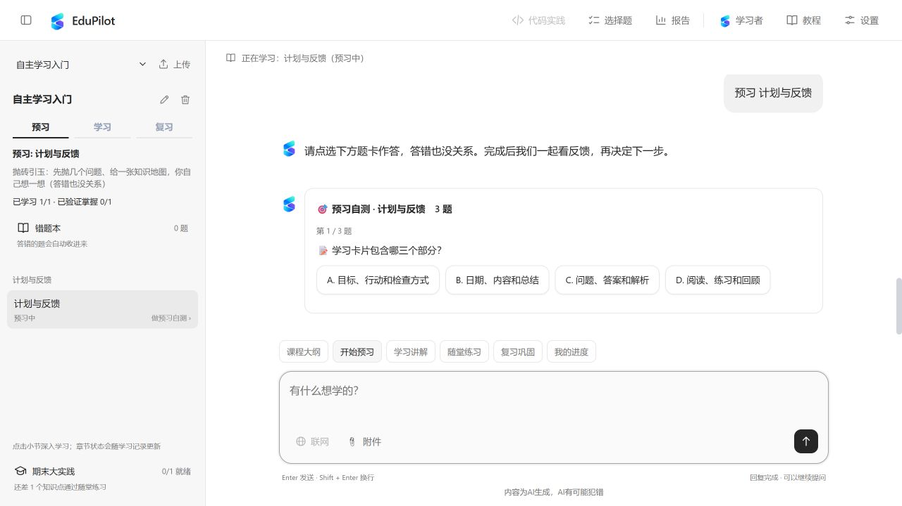

左侧选择课程与知识点，右侧跟随学伴提问、理解和练习。上图展示导入教材后的学习界面；也可以先用内置 Python 演示课熟悉整个流程。

看看内置课程与专注对话布局

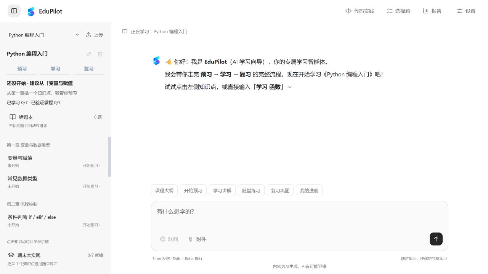

收起侧栏，为讲解和追问留出更大的空间。

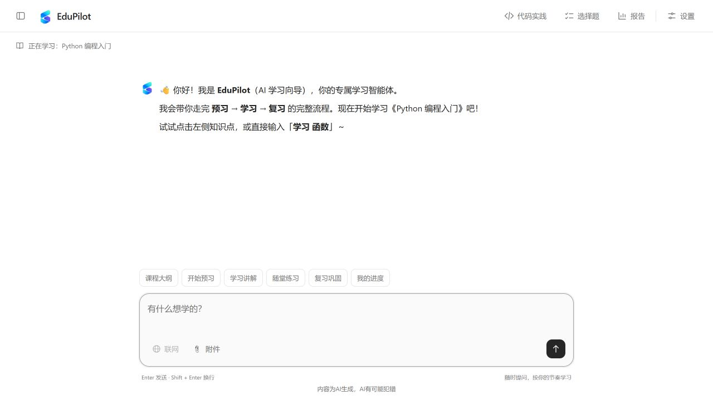

## 三步，开始你的第一节课

| 你的电脑 | 下载 |
| --- | --- |
| Windows x64 | [Windows 安装包](https://github.com/2092372408-pixel/EduPilot/releases/latest/download/EduPilot-Windows-Installer.zip) |
| Mac · Apple Silicon（M 系列芯片） | [Apple Silicon 安装包](https://github.com/2092372408-pixel/EduPilot/releases/latest/download/EduPilot-macOS-AppleSilicon-Installer.tar.gz) |
| Mac · Intel 芯片 | [Intel 安装包](https://github.com/2092372408-pixel/EduPilot/releases/latest/download/EduPilot-macOS-Intel-Installer.tar.gz) |

1. **下载并解压**上方对应平台的安装包。Mac M 系列芯片请选择 Apple Silicon。
2. **双击安装**：Windows 打开 EduPilot/install.bat；macOS 打开 EduPilot/install.command。安装后创建带图标的桌面入口，并打开学习页面。
3. **先体验，再导入**：无需密钥体验内置 Python 演示课；在设置中接入模型后，上传自己的教材，开始新的课程。

以后双击桌面 **EduPilot** 图标即可开始学习。关闭最后一个 EduPilot 页面后，后台服务会自动退出；刷新或切换到练习、报告页面可以继续使用。学习记录保存在本机，下次打开接着学。

首次打开有按钮指向式教程，带你认识选课、上传、提问、错题本和报告。可以跳过，也可以从顶部 **教程** 重新查看。macOS 首次打开若出现系统确认，请在 Finder 中右键选择“打开”。

第一次用，也有人带你上手

新手引导高亮真实按钮，用箭头和旁边的说明带你完成第一步，可以随时跳过或重看。

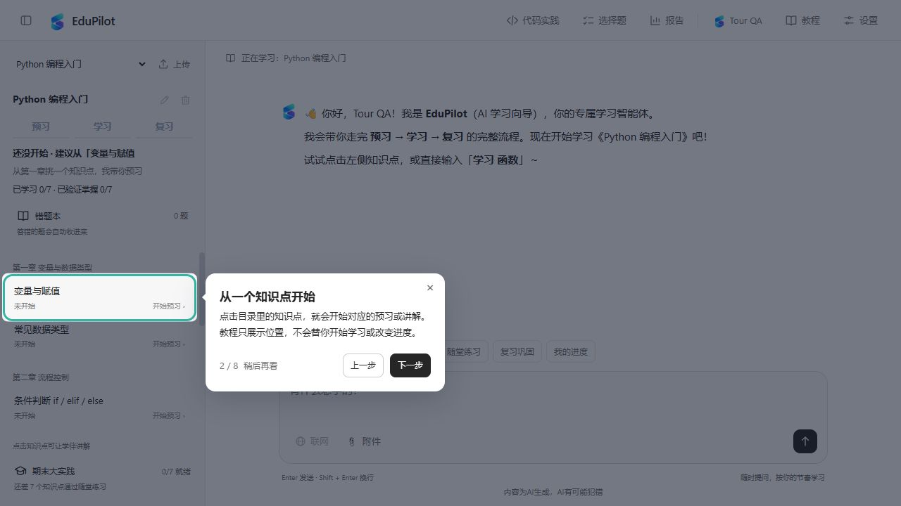

安装包自带 Node.js 和应用依赖，日常启动无需打开终端或手动修改配置文件。更多使用方式见 [桌面启动与退出说明](docs/桌面启动与退出说明.md)。

## 从一份教材，到一次完整学习

导入资料 → 自动成课 → 预习检测 → 学习与练习 → 查看学习报告。以下动图展示真实操作的关键步骤。

展开查看真实界面的学习演示

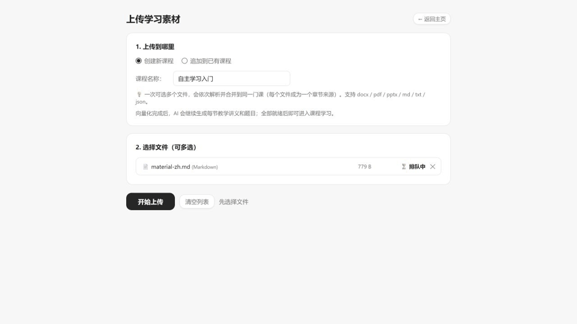

## 六个让学习更连贯的理由

### 1. 上传教材，自动组织成一门可以学的课

导入中英文 PDF、Word（.docx）、PowerPoint（.pptx）、Markdown、TXT 或 JSON，EduPilot 按章节整理内容，并生成知识点讲义、示例、易错点和配套选择题。资料准备好后，就能像内置演示课一样，按知识点开始学习。

从资料到课程，整个过程都可以看见：

- **保留章节结构**：优先识别原有标题，也支持“第一章”“Chapter 1”“1.1”等中英文标题；检索内容按识别出的章、节切分，保留出处。
- **看得见处理进度**：展示解析、分章切块、检索索引、讲义与题目生成、保存等阶段。解析时显示已用时间；向量化和课程生成显示实际完成数量。
- **围绕教材生成**：讲义和题目以原文为依据，生成后再对照原文检查讲解与答案，全部就绪后才进入学习。
- **逐步完善自己的课**：可以追加资料，复用未变化的内容、向量和讲义；更新失败时保留之前可用的课程。

看看教材导入与处理进度

侧栏点击 **上传**，创建新课程或追加到已有课程，选择资料后开始处理。完成后回到主页，就能选择生成的章节与知识点。

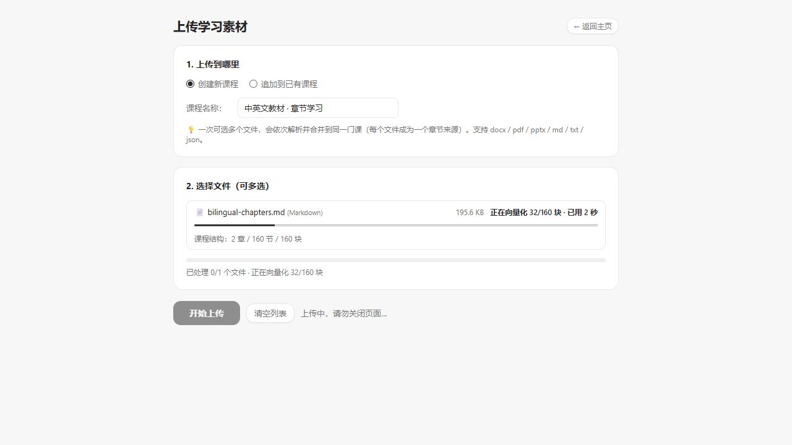

### 2. 预习 → 学习 → 复习，每一步都有下一步

先通过预习自测发现还不熟悉的地方，再跟随讲解建立理解，通过练习获得反馈，最后用复习巩固知识。遇到难点可以直接说“换个例子解释”或“我卡在这一步”，不用退出当前学习过程。

| 阶段 | 怎么学 | 如何继续 |
| --- | --- | --- |
| 预习 | 看知识地图，回答引导问题，完成预习自测 | 答完自测后进入学习，允许在预习中犯错 |
| 学习 | 看讲解、示例与易错点，完成随堂练习 | 随堂检测全对后进入复习 |
| 复习 | 回顾知识、重练薄弱点，完成复习测验 | 复习测验全对后记录为已掌握，并安排后续复习 |

每个知识点分别记录学习阶段。“看过了”和“通过检测了”分别呈现，帮助你把时间放在还需要练习的内容上。

在对话里完成学习与练习

题卡就在对话中，选择答案即可查看反馈与解释，选择题答案由服务端按题库核对。正式阶段检测用于推进进度；额外练习与错题重练则帮助巩固理解。

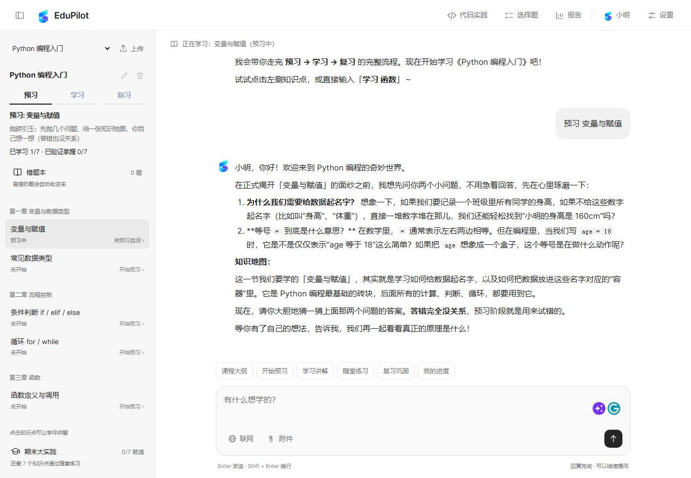

### 3. 记住你的目标，让下一次学习接得上

告诉学伴你的学习目标、基础和偏好，例如“我刚开始学 Python，希望多用生活中的例子”。这些有用的信息可以成为后续讲解的参考，不必每次从头介绍自己。

课程进度、对话和练习记录会保留在本机。学习目标与偏好可以跨课程使用，各门课程的进度和卡点分别记录；下次打开时，继续之前的课程，让一次次提问与练习逐渐积累成自己的学习路径。

学伴怎样连接前后的学习

当前目标和课程进度作为讲解的参考，过去的对话保留为可查找的记录，值得长期保留的信息按需要取用。较早的对话会形成摘要，发送给模型的上下文也有长度限制，控制长对话的输入量与使用费用。

长期记忆侧重明确的学习目标、稳定偏好和反复出现的困难。你可以在对话中说明新的目标或更正偏好，让后续学习适应变化。

### 4. 错题、复习与报告，帮你找到该花力气的地方

答错的题会进入错题本，可以查看自己的答案、正确答案与解析，再次练习。学习报告把课程进度、待完成检测和复习安排放在一起，方便决定接下来学什么。

主页、错题本和报告连接同一条学习路径：从报告找到待完成的检测，回到课程继续学；遇到需要巩固的知识点，再回来复习。学完内置 Python 课程、满足解锁条件后，还可以挑战综合测验，把分散的知识点连起来使用。

看看错题本与学习报告

从侧栏打开 **错题本**，查看答题记录并选择重练。

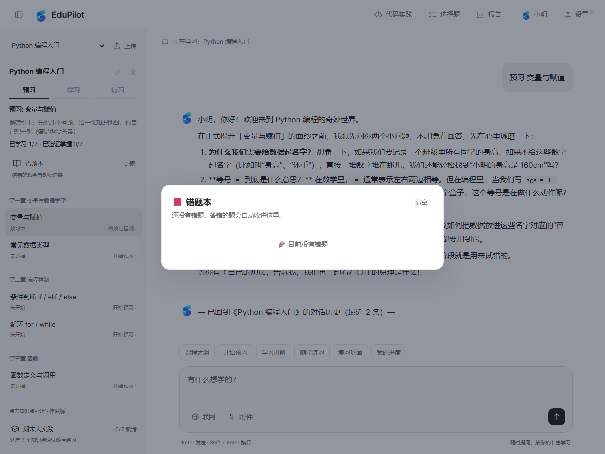

从顶部打开 **报告**，查看学习覆盖、已验证掌握、下一步与复习清单。

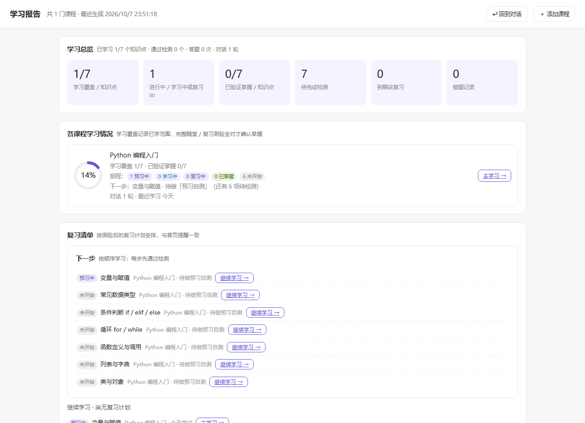

### 5. 既能跟着学，也能随时问、动手练

课程规划、预习、学习和复习各有专门的学伴角色配合；课程之外的问题，由通用教育学伴帮助解释、举例和提供学习建议。你可以沿着章节前进，也可以暂停下来探究一个感兴趣的问题。

- **带着材料提问**：把图片或文档附在问题旁，结合内容一起讨论；图片提问请选择支持图片输入的模型。
- **按需联网查资料**：通过输入框旁的联网开关，补充查找与学习相关的资料。联网搜索需单独配置 Tavily Key。
- **Python 动手实践**：在代码实践区写代码、运行、提交并查看反馈。做题助手能结合当前题目和运行结果提供提示。

看看附件提问、选择题与 Python 实践

在输入框旁添加附件，带着具体材料追问。

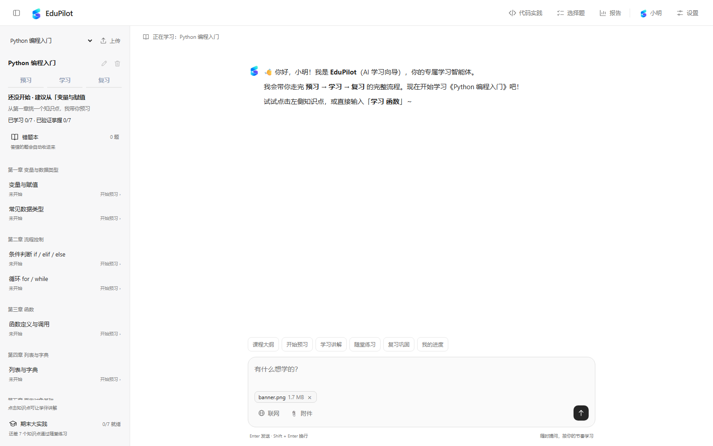

内置 Python 课程提供独立的选择题与代码实践区；导入课程的配套选择题在学习对话中完成。

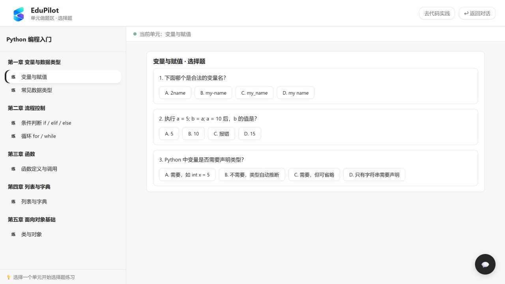

先运行代码查看输出，再提交获取判分反馈；卡住时打开做题助手。

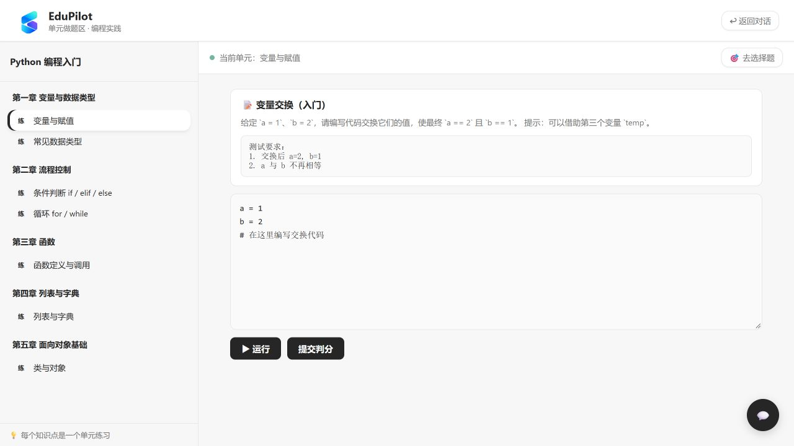

### 6. 在自己的电脑上学习，用顺手的模型与语言

支持 Windows 和 macOS，安装后双击桌面图标即可打开。关闭最后一个学习页面后，后台服务自动退出；课程、对话、错题和学习记录保存在本机，下次打开接着学。

界面支持中文和英文，也可以调整字号、收起侧栏。模型由你选择：接入 DeepSeek、Qwen、OpenAI、GLM、Kimi 等服务，或使用兼容接口的其他服务，让学伴适应自己的使用习惯。

文档解析在本机完成；接入在线模型或联网搜索时，相关问题、教材片段或附件会发送到所选服务商。你可以根据需要决定使用哪些能力。

看看语言与显示设置

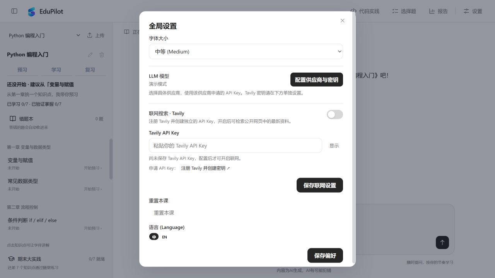

## 接入你喜欢的模型

打开 **设置 → LLM 模型 → 配置供应商与密钥**，选择供应商，填入 API Key，选择模型并保存。开放问答、自己的教材讲义与题目生成使用所选模型，费用由服务商收取。

支持 DeepSeek、Qwen、OpenAI、GLM、Kimi 等服务及兼容接口。联网搜索可在 **设置 → 联网搜索 · Tavily** 中填写 [Tavily Key](https://app.tavily.com/home)，按需开启。

可以先 **测试连接**，再保存启用；列表没有需要的模型时，填写服务商提供的自定义 Model ID。发送图片前，选择支持图片输入的模型并测试图片能力。

看看模型配置界面

在界面中选择供应商、查看模型能力提示并填写密钥，无需手动修改配置文件。

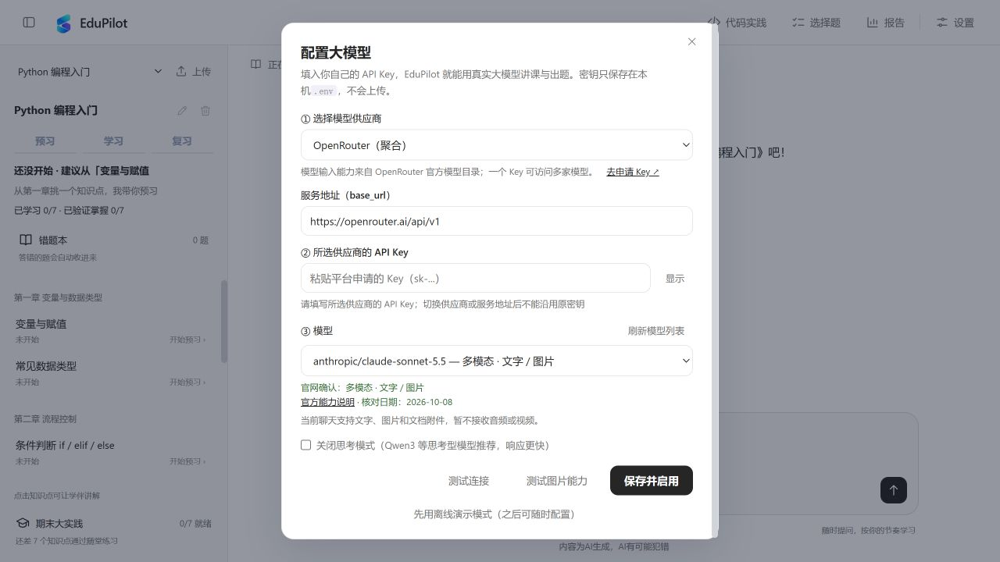

查看各供应商的官方密钥入口

| 供应商 | 官方入口 |
| --- | --- |
| DeepSeek | [创建 API Key](https://platform.deepseek.com/api_keys) |
| 阿里云百炼 · Qwen | [控制台](https://bailian.console.aliyun.com/) |
| OpenAI | [创建 API Key](https://platform.openai.com/api-keys) |
| 智谱 · GLM | [创建 API Key](https://open.bigmodel.cn/usercenter/apikeys) |
| Moonshot · Kimi | [创建 API Key](https://platform.kimi.com/console/api-keys) |
| 硅基流动 | [创建 API Key](https://cloud.siliconflow.cn/account/ak) |
| 火山方舟 · 豆包 | [控制台](https://console.volcengine.com/ark) |
| OpenRouter | [创建 API Key](https://openrouter.ai/keys) |

## 你可能想知道

**没有 API Key，可以先用吗？**

可以。内置 Python 演示课无需密钥，适合熟悉学习流程。真实开放问答和自己的教材成课需要接入模型，联网搜索使用单独的 Tavily Key。

**中英文教材都支持吗？**

支持中英文内容及界面。PDF 请使用可提取文字的版本，扫描件需要先转成文字。

**为什么答对了，进度还没有变成“已掌握”？**

各阶段检测分别记录。完成预习自测解锁学习，随堂检测全对解锁复习，复习测验全对才记录为已掌握。额外练习和错题重练不代替正式阶段检测。

**资料和学习记录存在哪里？**

教材解析在本机完成，课程、对话和学习记录保存在自己的电脑上。使用在线模型或联网功能时，相关问题、教材片段或附件会发送到你选择的服务商。

**需要额外安装环境吗？**

安装包自带应用运行环境，演示课和普通文档解析可以直接体验。Python 代码实践需要安装 Python；可选的本地语义检索需要额外配置 Python 与向量模型，未配置时使用关键词检索。

**教材导入需要多久？可以关掉页面吗？**

耗时取决于文件内容、章节数量、本机性能与所选模型的响应速度。文档解析在本机进行；讲义、题目生成和检查会调用所选模型。页面展示当前阶段与实际完成数量，请等课程就绪后再关闭。若失败，可按提示重试；更新已有课程失败时，之前可用的版本会保留。

**关掉网页就退出了吗？刷新会不会退出？**

从桌面图标启动时，关闭最后一个 EduPilot 页面后约 15 秒自动停服；保留任一工作台、练习或报告页面即可继续使用，刷新会重新连接。已接受的处理任务会有一小段保存时间。下次双击桌面图标即可重新打开；需要立即停止时，也可以使用安装目录里的 stop.bat 或 stop.command。

**升级会保留之前的学习吗？**

用新版安装包更新同一用户的安装目录，会保留模型配置、课程和学习数据。升级前关闭 EduPilot 页面，让旧服务退出后再安装。

## 我们的初心

我们希望教育能够更科学、更流程化，也真正把学习的主动权交还给每一个人。科学化、流程化并不意味着把所有人放进同一个模板，而是让目标、探索、反馈和复习都有迹可循。学生不必只等待老师安排下一步，可以按照自己的兴趣主动提问、尝试、回顾，再决定要走向哪里。

学习也不该是一段段互不相连的台阶。它是一条贯穿一生的连续路径：过去的理解会成为今天的起点，今天的困惑也会为明天留下线索。EduPilot 希望用 AI 记录这条路径，让每一次提问、练习、犯错和进步都成为下一次学习可以继续利用的经验。

在 AI 快速发展的今天，学习速度与学习效率越来越重要。我们希望帮助更多人更高效、更连贯地学习，同时保留探索的自由，最终能够学自己真正想学的，并去做自己真正想做的事。

> **学自己想学的，做自己想做的。你的每一步，都值得被记录。**

## 一起让学习更顺手

有使用建议、想学的课程或遇到问题，欢迎通过 [GitHub Issues](https://github.com/2092372408-pixel/EduPilot/issues) 或 [邮箱](mailto:qiuyanzihan2004@gmail.com) 告诉我们。

© 2026 **Qiu Yanzihan** · 个人与非商业使用请参阅 [使用许可](LICENSE)；商业合作请联系作者。第三方材料的条款见 [第三方许可说明](THIRD_PARTY_NOTICES.md)。
