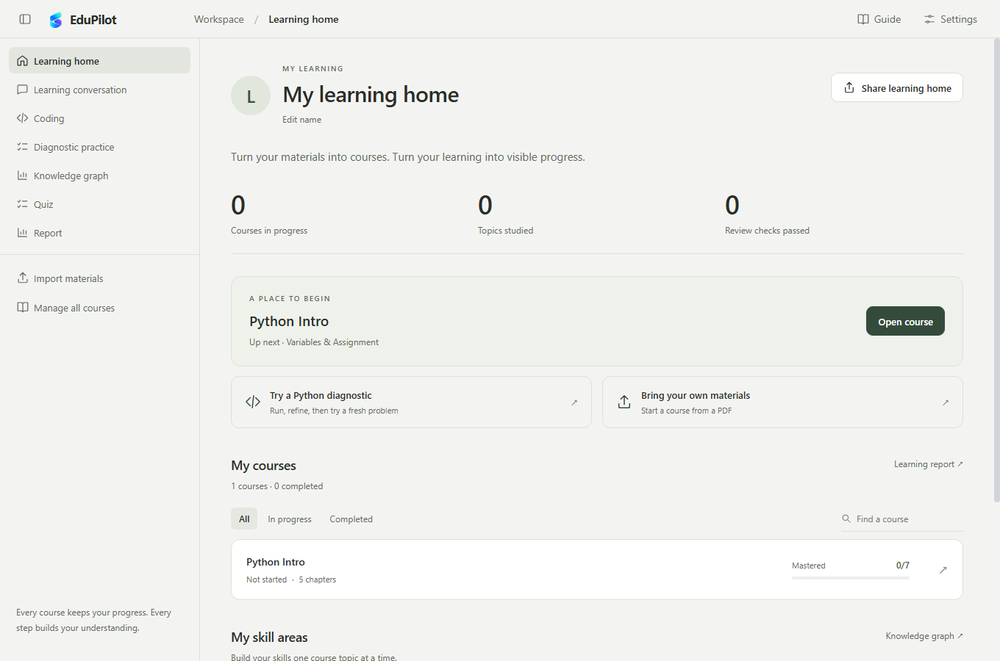

<p align="right"><a href="README.md">简体中文</a> | <strong>English</strong></p>

<p align="center"></p>

<h1 align="center">EduPilot · Your AI Learning Companion</h1>

<p align="center"><strong>Turn materials into a course. Make your progress visible.</strong></p>

<p align="center">Windows / macOS desktop app · English and Chinese · Your choice of AI model</p>

EduPilot brings **your materials, practice and progress** into one AI learning workspace. Study chapter by chapter, check your understanding through exercises and review, and connect ideas in your knowledge graph. Your personal learning home brings courses and skills together, so you can pick up where you left off and share what you have learned.

**[Try a built-in Python diagnostic exercise, then bring your own materials.](#quick-start)**

<p align="center"><a href="#download">Download</a> · <a href="#features">Features</a> · <a href="#quick-start">Get started</a> · <a href="#workspace">Demo</a> · <a href="#docs">Docs</a></p>

<a id="download"></a>

## Download v2.1.0

| Platform | Installer |
| --- | --- |
| Windows x64 | [Download Setup.exe](https://github.com/2092372408-pixel/EduPilot/releases/download/v2.1.0/EduPilot-2.1.0-Windows-x64-Setup.exe) |
| macOS · Apple Silicon (M-series) | [Download Apple Silicon DMG](https://github.com/2092372408-pixel/EduPilot/releases/download/v2.1.0/EduPilot-2.1.0-macOS-arm64.dmg) |
| macOS · Intel | [Download Intel DMG](https://github.com/2092372408-pixel/EduPilot/releases/download/v2.1.0/EduPilot-2.1.0-macOS-x64.dmg) |

Installers include the application runtime, Python and document conversion dependencies. See the [desktop guide (Chinese)](docs/桌面启动与退出说明.md) for installation and upgrades, or the [Release page](https://github.com/2092372408-pixel/EduPilot/releases/tag/v2.1.0) for more downloads.

<a id="features"></a>

## Core features

### Turn materials into a course

Import Chinese or English PDF, Word, PowerPoint, Markdown, TXT or JSON files and organise them into chapters. Explore explanations, ask follow-up questions and answer practice questions grounded in the original materials.

### Preview → Learn → Review

Specialist learning companions support planning, explanations and practice, with progress tracked for each topic. Your mistake notebook, review schedule and learning report help you choose the next step, while goals and preferences carry into later conversations.

### Python diagnostic practice

Practise branch conditions, loop bounds and sums, and function returns in the built-in Python course. Run code and compare failing inputs, expected results and actual output. Request tiered hints, correct your solution, then try a fresh variant, with corrections and first attempts on new tasks recorded separately.

### Personal knowledge graph

Connect courses, chapters and concepts, and inspect their sources and learning records. Search for a topic, add notes and confirm links across courses to build your own knowledge network.

### Your personal learning home

See progress across your courses, topics that have passed review and the skill areas you are building. Continue a course, or choose courses for a learning card with the project address and QR code. Save the image or share it with friends. [Preview a learning card →](docs/screenshots/learning-card-en.png)

### Course management

Search, open, rename or delete an uploaded course, and add or update its materials. Keep your course collection in one workspace and return to earlier progress and conversations.

<a id="quick-start"></a>

## Get started in three steps

1. **Install and open**: run `Setup.exe` on Windows. On macOS, open the DMG and drag EduPilot into Applications.
2. **Try an exercise**: open **Diagnostic practice** and choose branches, loops or functions in the built-in Python course. Submit code, read the feedback, then try a fresh variant. No API key is needed for this step.
3. **Study your own materials**: in **Settings → LLM model**, connect DeepSeek, Qwen, OpenAI, GLM, Kimi or another compatible service, test the connection and save. Select **Import materials** from your learning home and start learning chapter by chapter.

Graph organisation and built-in diagnostic tasks, grading and tiered hints work right away. AI conversations and generated course content use your chosen model service; relevant questions, material excerpts or attachments are sent to that provider.

Select **Guide** at the top for a walkthrough whenever you need one. See the [learning guide (Chinese)](docs/学生端说明书.md) for detailed instructions.

<a id="workspace"></a>

## Your learning home

Open EduPilot to see your courses and progress, pick up where you left off, and share a learning card.



<details>
<summary>Watch the materials-to-learning demo</summary>

Import materials → Create a course → Preview check → Learn and practise → View your report.


</details>

<a id="source"></a>

<details>
<summary>Developers: run from source</summary>

With Node.js 22+ and Python 3 installed, run:

```bash
git clone https://github.com/2092372408-pixel/EduPilot.git
cd EduPilot
npm ci --omit=dev
npm start
```

Open [http://127.0.0.1:8787](http://127.0.0.1:8787) and connect a model in Settings. Document conversion and local semantic search also need the [Python dependencies](requirements-docker.txt).

See the [development guide (Chinese)](docs/桌面启动与退出说明.md#源码与桌面开发) for native desktop development and packaging.

</details>

<a id="docs"></a>

## Docs and feedback

- [Learning guide (Chinese)](docs/学生端说明书.md): navigation, practice, graphs and everyday use.
- [Desktop guide (Chinese)](docs/桌面启动与退出说明.md): installation, launch and exit, backups and upgrades.
- [v2.1.0 release notes](docs/releases/v2.1.0.md).
- [GitHub Issues](https://github.com/2092372408-pixel/EduPilot/issues): report a problem or share an idea.

> Learn what you want, then do what you want.

© 2026 **Qiu Yanzihan** · For personal and noncommercial use, see the [license](LICENSE) · [Third-Party Notices](THIRD_PARTY_NOTICES.md)
