
<a href="README.md">简体中文</a> | <strong>English</strong>

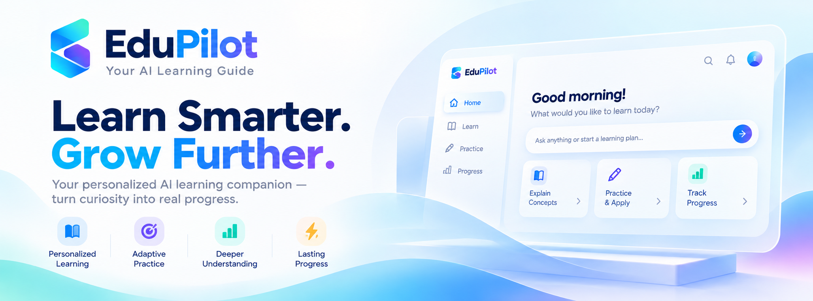

<h1 align="center">EduPilot · Your AI Learning Companion</h1>

<strong>Connect your materials, practice and knowledge—with a record of every learning step.</strong>

Turn materials into courses, practise with execution feedback, connect topics in a personal graph, and follow run activity. Native desktop app for Windows / macOS · English and Chinese · Connect your own model API key

  
  
  
  

<a href="#download">Download v3</a> · <a href="#whats-new">New in v3</a> · <a href="#workspace">Core workspace</a> · <a href="#features">Materials & learning</a> · <a href="#demo">Learning demo</a> · <a href="#api-keys">Connect a model</a> · <a href="#faq">FAQ</a>

## Start with your materials. Build your own understanding.

EduPilot is an AI learning workspace that runs on your computer. Import Chinese or English materials and work through Preview, Learn and Review. Ask follow-up questions, consult the source material and practise what you understand. Courses, conversations and study records stay local; online AI features use the model service you choose.

**v3 connects practice, knowledge relationships and run controls into the same learning journey.** See concrete inputs and results when code fails, correct it, then try a fresh task. A personal graph connects courses, chapters and concepts. Run activity shows how a request is progressing, while course management keeps your material collection organised.

| What you want to do | Where v3 helps |
| --- | --- |
| Understand a coding error and try a fresh problem independently | [Diagnostic practice](#diagnostic-practice): execution feedback, tiered hints, separate correction and first-attempt records |
| Connect what you have studied with what comes next | [Personal knowledge graph](#knowledge-graph): sources, learning evidence, personal notes and cross-course links |
| See what the AI is doing and control the current run | [Run activity](#run-activity): status, calls and usage, cancellation and eligible continuation |
| Organise courses you no longer need or want to rename | [Course management](#course-management): search, open, rename, delete an individual course and retry cleanup |

Textbook-grounded retrieval (RAG), specialist learning roles, the mistake notebook, reports and the **Preview → Learn → Review** flow remain part of EduPilot. **For independent study, course revision, personal learning libraries and hands-on Python practice.**

## Download v3.0.0 and start your first lesson

Download the native desktop app and start learning from its icon, with no server to manage or separate Node.js / Python installation. The app uses its own window, stays in the tray when closed, and automatically attempts to recover a failed backend.

| Your computer | Download |
| --- | --- |
| Windows x64 | [Download Setup.exe](https://github.com/2092372408-pixel/EduPilot/releases/download/v3.0.0/EduPilot-3.0.0-Windows-x64-Setup.exe) |
| Mac · Apple Silicon (M-series chips) | [Download Apple Silicon DMG](https://github.com/2092372408-pixel/EduPilot/releases/download/v3.0.0/EduPilot-3.0.0-macOS-arm64.dmg) |
| Mac · Intel | [Download Intel DMG](https://github.com/2092372408-pixel/EduPilot/releases/download/v3.0.0/EduPilot-3.0.0-macOS-x64.dmg) |

1. **Download** the installer for your computer. Choose Apple Silicon for an M-series Mac.
2. **Double-click to install**: run `Setup.exe` on Windows and follow the prompts. On macOS, open the `.dmg` and drag EduPilot into Applications.
3. **Connect a model and start learning**: choose your provider and model in Settings, enter your own API key, test the connection and save. Then study the built-in Python course or import your own materials.

Next time, open **EduPilot** from the Windows desktop or Mac Launchpad. Closing the window hides it to the tray (the menu bar on Mac) while the backend keeps running. Select **Quit EduPilot** from the menu to exit completely. Your study records stay on your computer for your next session.

A tour points to real controls on your first visit, introducing courses, uploads, questions, mistakes and reports. Skip whenever you like, or select **Guide** at the top to replay it. Current installers are unsigned, and Mac packages are not notarized; your OS may warn or block opening them. Check the attachments and SHA-256 checksums on the [Release page](https://github.com/2092372408-pixel/EduPilot/releases/tag/v3.0.0). If you already use EduPilot, read the upgrade notes below before installing.

A guide for your first visit

The tour highlights real buttons, with arrows and nearby explanations to help you take the first step. Skip or replay it whenever you like. This screenshot is from an earlier version and illustrates the basic onboarding flow.

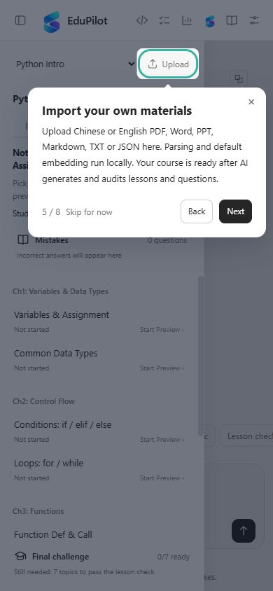

The native installer includes the application runtime, Python and document conversion dependencies. Diagnostic task generation, grading and tiered hints work without a model key. Online discussions and generated lessons require your own model service. Semantic search downloads a model on first use and falls back to keyword search if unavailable. See the [desktop launch and exit guide (Chinese)](docs/桌面启动与退出说明.md) for more details.

### Upgrading from an earlier version

Choose **Quit EduPilot** from the app menu before installing; closing the window only hides it to the tray. Back up the entire user-data folder first: `%APPDATA%\EduPilot` on Windows, or `~/Library/Application Support/EduPilot` on macOS. The tray's **Open learning data folder** command (labelled “打开学习数据文件夹”) opens its `workspace/data` subfolder; go up two levels to find the folder to back up.

Installing v3 under the same OS user keeps using that data location. Courses, conversations, model settings and learning records are stored separately from program files. Updates are installed manually; data from older script packages is not migrated automatically. See the [upgrade guide (Chinese)](docs/桌面启动与退出说明.md#升级到-v300) for the backup procedure and storage details.

## New in v3: practice with evidence and a clear next step

### 1. Diagnostic practice: understand an error, then try a fresh task

Open **Diagnostic practice** in the built-in **Python Intro** course. Submit an attempt, compare failing inputs with the expected and actual results, request hints one level at a time, and correct the code before trying an unseen variant. The practice view and report distinguish corrections from first-attempt passes on new tasks. Back in the learning conversation, the tutor can refer to recent practice records.

Three topics are currently available:

| Topic | What you practise |
| --- | --- |
| Branches and parity | Choose a branch from the input, including zero and negative values |
| Loop bounds and sums | Accumulate values and handle closed-interval endpoints and empty intervals |
| Function returns and changing inputs | Compute from different inputs and distinguish returning from printing |

Grading uses actual code execution and implementation constraints explicitly stated in the task. Every variant is checked against a reference solution and curated incorrect programs before it is offered. AI discussion does not change the objective result. Task generation, grading and tiered hints need no model API key; the v3 desktop installer includes the required Python environment. **Discuss this problem** requires a configured model service. Diagnostic validation currently covers only those three built-in topics. Uploaded courses do not yet support diagnostic practice.

**How assistance is recorded:** the system distinguishes a known absence of in-app help, assistance used and unknown help history. When a discussion request for the current task is accepted, its help record is saved before the model call and remains even if the reply fails. Chat in the same course that is not bound to a task conservatively marks an unfinished task with no previously recorded help as having unknown help history. An independent check requires an unseen task to pass on its first verified submission with a known record of no in-app assistance. It does not detect external help, establish long-term mastery or replace the formal review assessment. Missing historical records are not turned into independent evidence.

Submitted code, hints and results are saved locally and remain available after refreshing. Repeated requests do not duplicate credit. Code runs in a local teaching runner with static prechecks and execution limits, intended for personal local practice rather than a public multi-user code execution service.

### 2. Personal knowledge graph: connect topics and keep their sources

Open **Knowledge graph** in the sidebar to browse courses, chapters and concepts in a graph or list. Search names and filter by course or learning status. Select a node to inspect its sources, recorded attempts and review results, suggested prior topics and personal notes, then return to the relevant course or a supported diagnostic task.

- **See where a link comes from:** course structure, curated study suggestions and user-added relationships have distinct provenance labels.
- **Confirm cross-course connections yourself:** same-title concepts appear as unconfirmed candidates. They are not merged automatically, and neither titles nor chapter order establish prerequisites.
- **Build your own understanding:** add related, prerequisite or applies-to links. A prerequisite cycle is rejected with an explanation.
- **Keep personal organisation separate from grades:** notes and links do not change scores. Practice, review and independent checks remain distinct evidence. A view includes at most 600 concepts, with a clear notice when content is truncated. Filters apply to the content loaded in that view.

### 3. Run activity: follow progress and control the current run

Expand **Run activity** in the learning conversation or diagnostic practice view to inspect status, confirmed steps, model and tool call counts, and settled and reserved tokens. Select **Cancel run** while it is active. Eligible interrupted, failed or cancelled runs offer **Resume run**.

Continuation shares the original budget and deadline and reuses confirmed writes. Changes to learning state or model configuration, exhausted limits, or a deleted or reset course can prevent continuation. Calls whose provider has not reported usage keep their reservation instead of counting as free. Activity helps you understand and control execution; actual charges are determined by your provider's bill.

### 4. Course management: organise your learning collection

Open **Manage courses** from the course selector to search, open, rename or delete an uploaded course without first switching to it. The built-in Python course is protected from renaming and deletion.

Deletion requires confirmation and cannot be undone in the app. It removes that course's materials, attachments, conversations, learning records, course memories, graph notes and links, and run records across profiles in this installation. Other courses and cross-course profile information remain. The deleted course becomes unavailable immediately, and unfinished old tasks cannot restore it. If any files or records cannot yet be removed, **Manage courses** keeps a **Retry cleanup** action.

## The workspace and core learning flow

The screenshots and animation below are from earlier versions and show the core import, conversation, practice and report flows. They are not screenshots of the new v3 features. Refer to the current app for Diagnostic practice, Knowledge graph, Run activity and Manage courses.

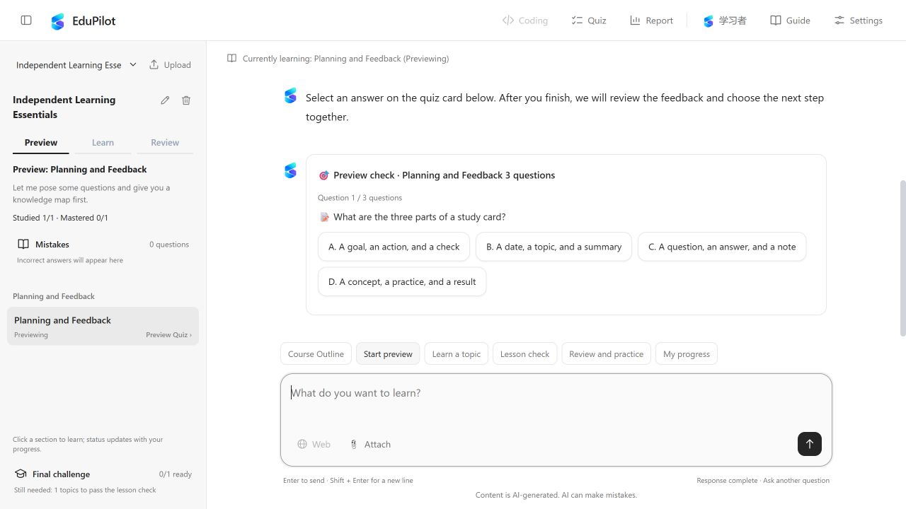

Choose a course and topic on the left, then ask, learn and practise with your companion on the right. After connecting a model, study the built-in Python course or import your own materials. Create and revisit conversations below the course outline. Chat context stays separate by course and conversation; progress and grades belong to each course. Long-term memory is retrieved across all courses for the same learner, with its sources retained. Practice, reports, imports and exams open within the application and preserve their state when you return.

See the built-in course and focused conversation layout

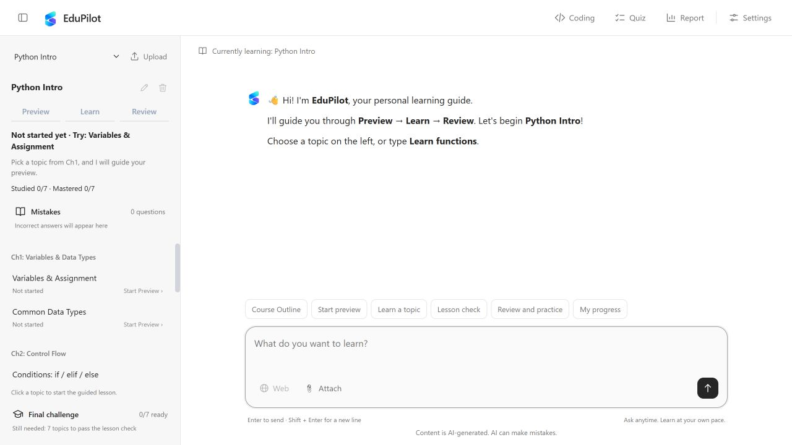

Collapse the sidebar to give explanations and follow-up questions more room.

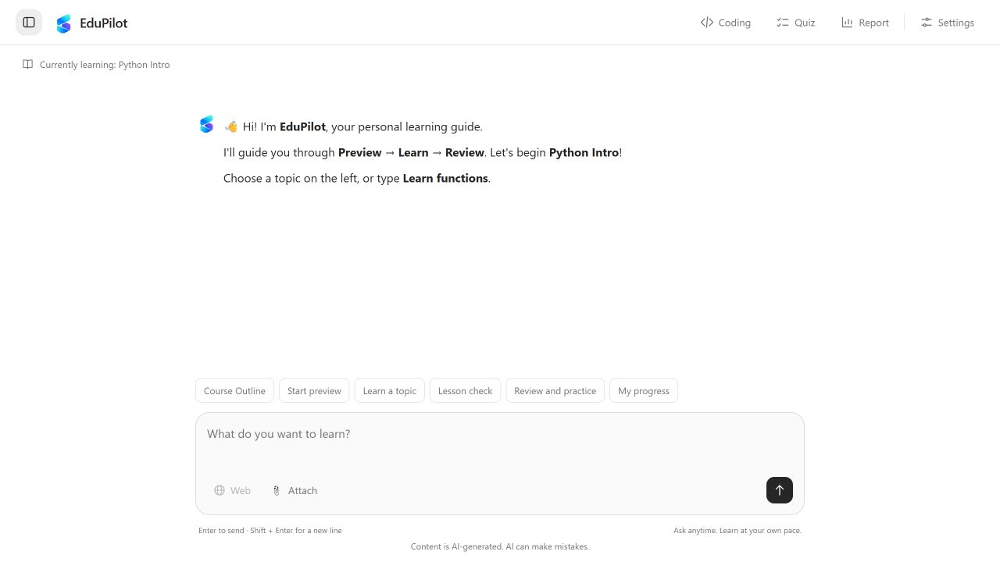

## From your materials to a complete study session

Import materials → Create a course → Preview check → Learn and practise → View your report. The earlier-version animation below shows key steps in this core learning flow.

Watch the learning flow in the actual interface

## Materials, conversations and the complete learning flow

### 1. Turn a textbook into a course you can work through

Import Chinese or English PDF, Word (.docx), PowerPoint (.pptx), Markdown, TXT or JSON files. EduPilot organises chapters and text locally so you can start learning. Explanations and multiple-choice practice are generated by your selected model when needed.

Follow the process from your materials to a ready-to-study course:

- **Keep the chapter structure**: existing headings come first, with support for headings such as “第一章”, “Chapter 1” and “1.1”. Retrieval passages respect detected chapter and section boundaries and retain their sources.
- **See processing progress**: follow parsing, chapter splitting and saving, with elapsed time.
- **Generate from your source**: learning and practice use the relevant section as context; questions are generated on demand and saved. Check model output against your materials.
- **Grow your course over time**: add or replace materials. A failed update preserves the previous usable course.

See material import and processing progress

Select **Upload** in the sidebar, create a course or add to an existing one, then choose your materials and start processing. When ready, return to the workspace and select the generated chapters and topics.

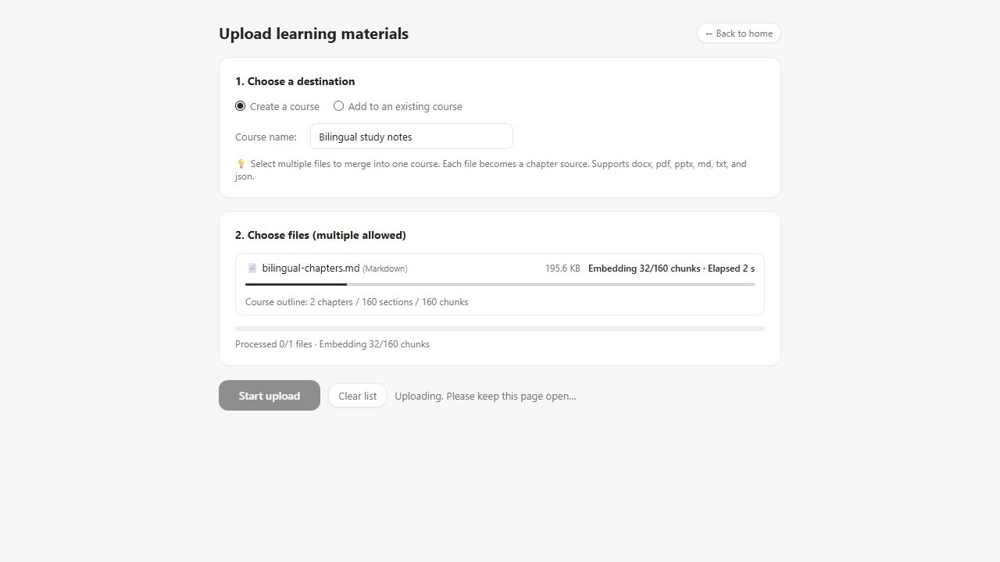

### 2. Preview → Learn → Review, with a next step throughout

First explore the chapter, then use a preview check to discover what is unfamiliar. Build understanding through explanations, practise, and revisit the topic. Ask for another example or explain where you got stuck without leaving the learning flow.

| Stage | How you learn | How you move forward |
| --- | --- | --- |
| Preview | Explore the topic map, answer guiding questions and complete a preview check | Finish the check to enter Learn; mistakes are welcome during preview |
| Learn | Work through explanations, examples and common pitfalls, then practise | Answer every question in the lesson check correctly to enter Review |
| Review | Revisit ideas and weak spots, then complete a review test | Answer every review question correctly to record mastery and schedule future review |

Each topic has its own learning stage. Content you have studied and topics you have passed are shown separately, helping you focus on what still needs practice.

Learn and practise in the conversation

Answer question cards directly in the conversation, then continue with feedback and explanations. Multiple-choice answers are checked against the question bank on the server. Formal stage checks advance progress; extra practice and retrying mistakes help consolidate understanding.

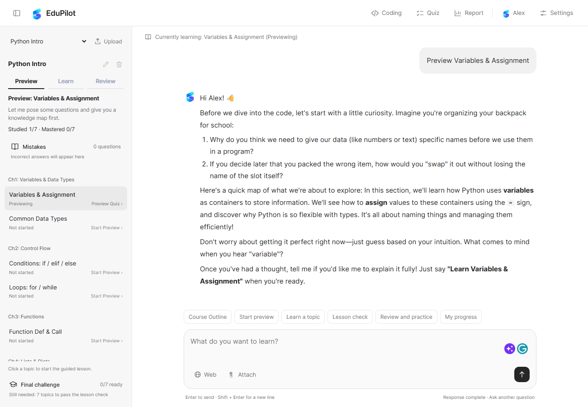

### 3. Keep your goals in view—and pick up where you left off

Tell your companion about your goals, starting point and preferences: “I'm new to Python; everyday examples help me.” Useful information from your study sessions can inform later explanations, so you do not have to introduce yourself each time.

Course progress, conversations and practice history stay on your computer. Goals and preferences can carry across courses, while each course keeps its own progress and difficulties. Come back to the course you were studying, and let your questions and practice build into a continuous learning journey.

How your companion connects study sessions

Your current goals and course progress inform explanations. Earlier conversations remain searchable, and useful long-term information is retrieved when relevant. Older dialogue is summarised, and model context has a length limit to manage the input volume and cost of longer conversations.

Long-term memory focuses on explicit study goals, stable preferences and recurring difficulties. Tell your companion when a goal or preference changes so later sessions can adapt.

### 4. Use mistakes, review and reports to focus your effort

Incorrect answers go into your mistake notebook, where you can revisit your answer, read the correct answer and explanation, and try again. Your learning report brings course progress, pending checks and review plans together to help you choose what comes next.

The workspace, notebook and report connect the same learning journey: find a pending check in your report and return to the course, or revisit a topic that needs reinforcement. After meeting the completion requirements in the built-in Python course, take a comprehensive assessment and put the topics together.

See the mistake notebook and learning report

Open **Mistakes** in the sidebar to revisit answers and retry a question.

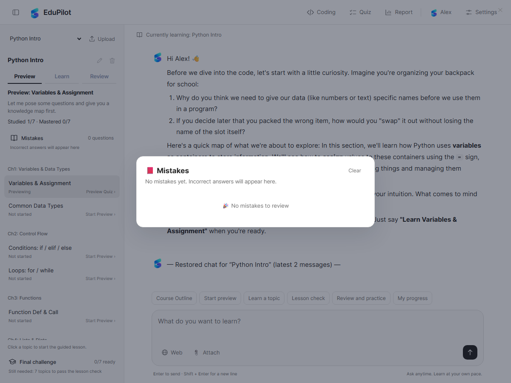

Open **Report** in the sidebar to see study coverage, verified mastery, next steps and review plans.

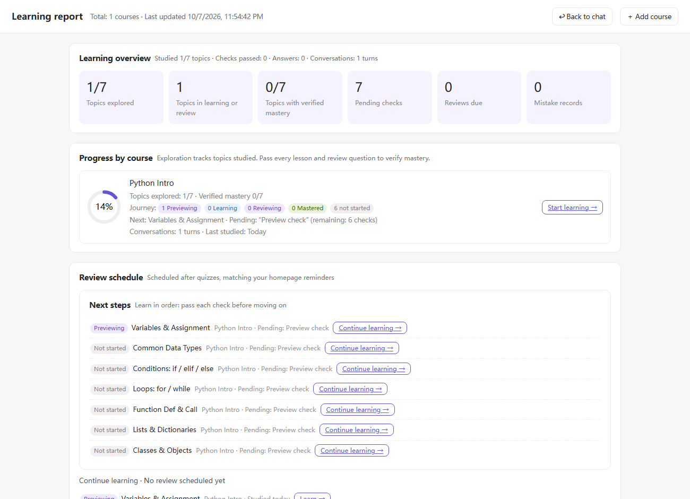

### 5. Follow a course, ask a question, or try it yourself

Dedicated companion roles support planning, preview, learning and review. A general education companion helps with questions beyond the course, offering explanations, examples and study advice. Follow the chapters or pause to explore a question that interests you.

- **Ask with your materials**: attach an image or document to discuss it alongside your question. Choose an image-capable model for pictures.
- **Research when needed**: use the toggle beside the input box for provider-native search with your existing model key. Availability depends on the model and region; expand the source button to inspect references.
- **Practise Python**: write, run and submit code for feedback. The practice assistant can use the current task and execution results to offer hints.

See attachments, multiple-choice practice and Python coding

Add an attachment beside the input box and ask about the material.

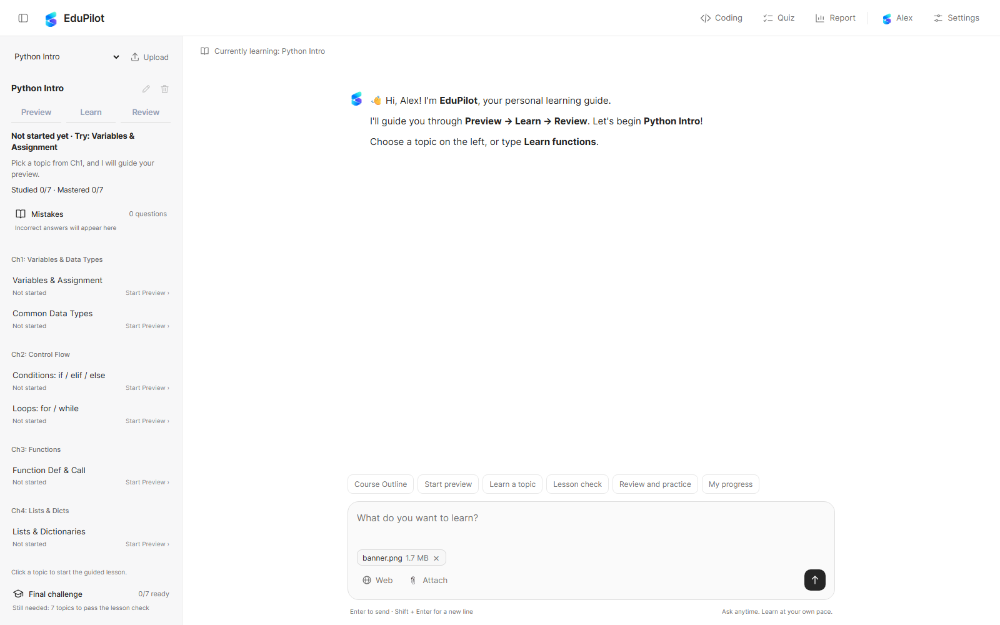

The built-in Python course has separate multiple-choice and coding workspaces. Imported courses provide their generated multiple-choice questions in the learning conversation.

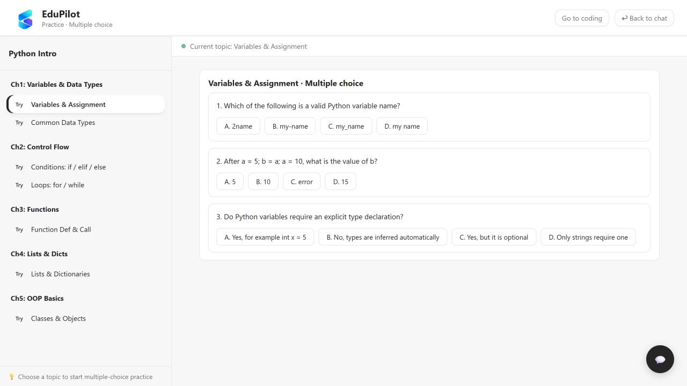

Run code to inspect its output, then submit for grading feedback. Open the practice assistant when you need a hint.

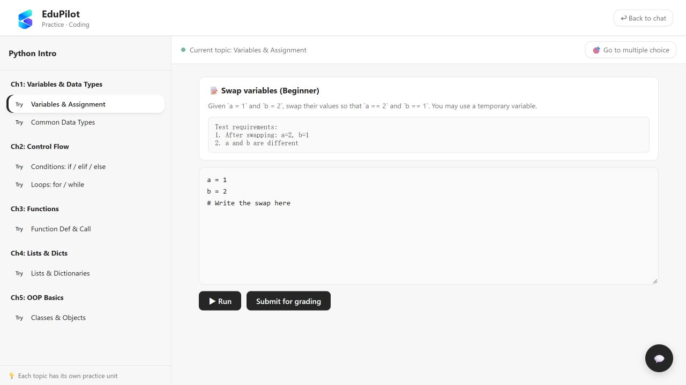

### 6. Learn on your computer, with your choice of model and language

Available for Windows and macOS. Double-click the icon to open your workspace. The native app stays in the tray when its window closes; select Quit EduPilot to stop it. Browser-based compatibility packages stop after their last page closes. Courses, conversations, mistakes and study records stay on your computer.

Switch between English and Chinese, adjust the text size or collapse the sidebar. Connect DeepSeek, Qwen, OpenAI, GLM, Kimi or another compatible service, and choose the model that suits how you learn.

Documents are parsed locally. When you use an online model or web search, relevant questions, material excerpts or attachments are sent to your selected provider. Choose which capabilities you want to use.

See language and display settings

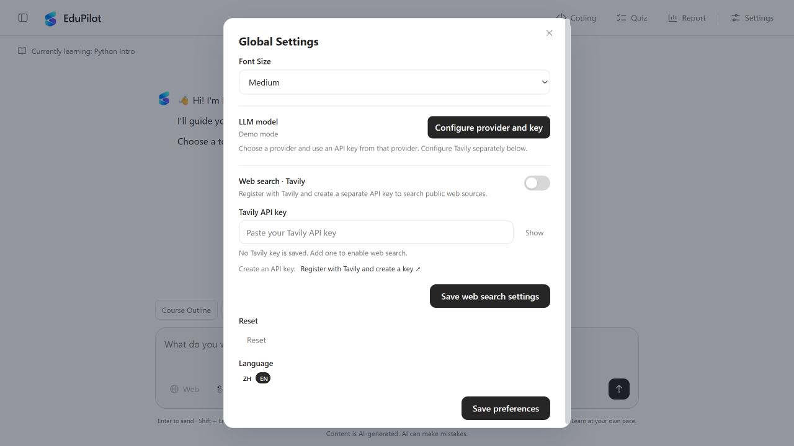

## Connect your preferred model

Open **Settings → LLM model → Configure provider and key**. Choose a provider, enter your API key, select a model and save. Open-ended answers and generating lessons and questions from your materials use this model and are billed by its provider.

Connect DeepSeek, Qwen, OpenAI, GLM, Kimi or another compatible service. Settings show native search availability; control it with the toggle beside the input box, without a separate search key. Model support and search charges depend on the provider. Unsupported configurations never pretend to have searched.

Use **Test connection** before saving. If the model you need is missing from the list, enter its provider-supplied custom Model ID. Before sending pictures, select a model that supports image input and test its image capability.

See model configuration

Choose a provider, check model capability labels and enter your key in the interface, without editing configuration files.

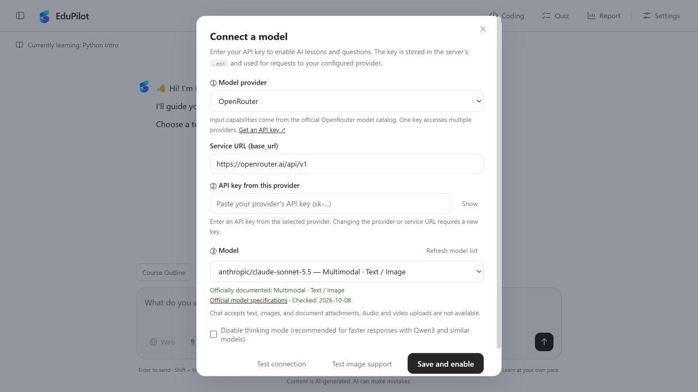

Official API key pages

| Provider | Official page |
| --- | --- |
| DeepSeek | [Create an API key](https://platform.deepseek.com/api_keys) |
| Alibaba Cloud Model Studio · Qwen | [Console](https://bailian.console.aliyun.com/) |
| OpenAI | [Create an API key](https://platform.openai.com/api-keys) |
| Zhipu · GLM | [Create an API key](https://open.bigmodel.cn/usercenter/apikeys) |
| Moonshot · Kimi | [Create an API key](https://platform.kimi.com/console/api-keys) |
| SiliconFlow | [Create an API key](https://cloud.siliconflow.cn/account/ak) |
| Volcengine Ark · Doubao | [Console](https://console.volcengine.com/ark) |
| OpenRouter | [Create an API key](https://openrouter.ai/keys) |

## A few things you might want to know

**Can I try it without an API key?**

Yes. Browse existing courses and records, organise your personal graph, and use diagnostic task generation, grading and tiered hints for the three built-in topics without a key. AI conversations, task discussions, and generated lessons and multiple-choice questions for imported materials require a provider, model and API key. Failed requests display an error instead of switching to demo answers. Supported native search uses the same provider key.

**Does it support Chinese and English materials?**

Yes, in both content and interface. Use PDFs with extractable text; scanned pages need to be converted to text first.

**Why did a correct answer not mark a topic as mastered?**

Each stage has its own check. Finishing the preview check unlocks Learn; a fully correct lesson check unlocks Review; a fully correct review test records mastery. Diagnostic corrections or independent checks, extra practice and retrying mistakes do not replace formal stage checks. “Mastered” means the relevant review assessment was passed, not a guarantee of long-term learning.

**Where are my materials and study records stored?**

Materials are parsed on your computer, where courses, conversations and study records are stored. When you use an online model or web search, relevant questions, textbook excerpts or attachments are sent to your selected provider.

**Do I need to install anything else?**

The native installer includes the application runtime, Python and document conversion dependencies. Local semantic search downloads an embedding model on first use and falls back to keyword search if unavailable. Older browser-based packages still need a separate Python installation for coding practice.

**How long does importing take? Can I close the page?**

Import time depends on the materials and your computer. Parsing and indexing run locally; explanations and questions use the selected model when needed. The page shows the current stage. A failed update preserves the previous usable course. Scanned documents and complex graphics may need OCR or manual review.

**Does closing the page quit the app? What about refreshing?**

Closing the native window hides it to the tray while the backend keeps running. Click the tray icon or launch the app again to return; select Quit EduPilot to exit completely. Older browser-based packages stop about 15 seconds after their last page closes. Refreshing does not stop the backend.

**Will upgrading keep my learning history?**

The native app keeps using the same OS user's data folder for settings, courses and learning records. Quit completely and back up that whole folder before installing. There is no in-app automatic update flow. Data from older script packages remains in its original folder and is not migrated automatically. See the [upgrade guide (Chinese)](docs/桌面启动与退出说明.md#升级到-v300).

## Why we built EduPilot

We want education to be more scientific, more structured, and more firmly in the learner's hands. A clear process should not force everyone into the same template. It should make goals, exploration, feedback, and review visible. Learners should not have to wait for a teacher to arrange every next step; they should be able to ask, try, reflect, and choose where to go next.

Learning is also a lifelong, continuous path rather than a staircase of disconnected levels. What you understood yesterday becomes today's starting point, while today's questions leave useful clues for tomorrow. EduPilot uses AI to preserve that continuity, so every question, exercise, mistake, and breakthrough can support what comes next.

As AI develops rapidly, the speed and efficiency of learning matter more than ever. We want to help more people learn efficiently and continuously without losing the freedom to explore, so they can learn what they truly want to learn and then do what they truly want to do.

> **Learn what you want, then do what you want. Every step deserves to be recorded.**

## Help make learning feel better

Have a suggestion, a course you would like to study or a problem to report? Tell us through [GitHub Issues](https://github.com/2092372408-pixel/EduPilot/issues) or [email](mailto:qiuyanzihan2004@gmail.com).

© 2026 **Qiu Yanzihan** · For personal and noncommercial use, see the [license](LICENSE). Contact the author for commercial collaboration. Third-party terms are listed in [Third-Party Notices](THIRD_PARTY_NOTICES.md).
