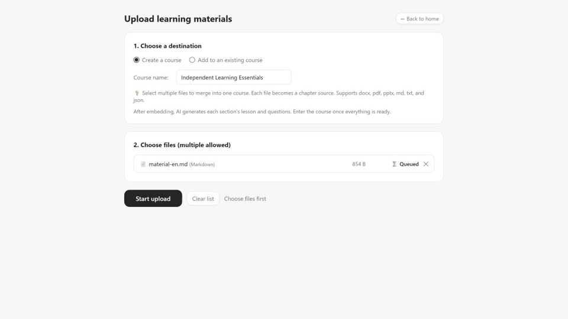

<p align="right"><a href="README.md">简体中文</a> | <strong>English</strong></p>

<p align="center"></p>

<h1 align="center">EduPilot · Your AI Learning Companion</h1>

<p align="center"><strong>Start with your materials. Connect understanding, practice and knowledge.</strong></p>

<p align="center">Windows / macOS desktop app · English and Chinese · Your choice of AI model</p>

EduPilot is an AI learning workspace that runs on your computer. Import your materials and work through Preview, Learn and Review. Test your understanding with coding practice and organise what you learn in a personal knowledge graph. Courses, conversations and study records stay local; AI explanations and conversations use the model service you choose.

<p align="center"><a href="#download">Download</a> · <a href="#features">Features</a> · <a href="#quick-start">Get started</a> · <a href="#workspace">Demo</a> · <a href="#docs">Docs</a></p>

<a id="download"></a>

## Download v2.0.0

| Platform | Installer |
| --- | --- |
| Windows x64 | [Download Setup.exe](https://github.com/2092372408-pixel/EduPilot/releases/download/v2.0.0/EduPilot-2.0.0-Windows-x64-Setup.exe) |
| macOS · Apple Silicon (M-series) | [Download Apple Silicon DMG](https://github.com/2092372408-pixel/EduPilot/releases/download/v2.0.0/EduPilot-2.0.0-macOS-arm64.dmg) |
| macOS · Intel | [Download Intel DMG](https://github.com/2092372408-pixel/EduPilot/releases/download/v2.0.0/EduPilot-2.0.0-macOS-x64.dmg) |

Installers include the application runtime, Python and document conversion dependencies. See the [desktop guide (Chinese)](docs/桌面启动与退出说明.md) for installation and upgrades, or the [Release page](https://github.com/2092372408-pixel/EduPilot/releases/tag/v2.0.0) for more downloads.

<a id="features"></a>

## Core features

### Turn materials into a course

Import Chinese or English PDF, Word, PowerPoint, Markdown, TXT or JSON files and organise them into chapters. Use textbook retrieval (RAG) to explore explanations, ask follow-up questions and answer practice questions grounded in your own materials.

### Preview → Learn → Review

Specialist learning companions support planning, explanations and practice, with progress tracked for each topic. Your mistake notebook, review schedule and learning report help you choose the next step, while goals and preferences carry into later conversations.

### Python diagnostic practice

Practise branch conditions, loop bounds and sums, and function returns in the built-in Python course. Run code and compare failing inputs, expected results and actual output. Request tiered hints, correct your solution, then try a fresh variant, with corrections and first attempts on new tasks recorded separately.

### Personal knowledge graph

Connect courses, chapters and concepts, and inspect their sources and learning records. Search for a topic, add notes and confirm links across courses to build your own knowledge network.

### Visible run activity

Follow execution steps, model and tool calls, and token usage. Cancel an active task or continue it when recovery is available, keeping the learning process easy to follow and control.

### Course management

Search, open, rename or delete an uploaded course, and add or update its materials. Keep your course collection in one workspace and return to earlier progress and conversations.

<a id="quick-start"></a>

## Get started in three steps

1. **Install and open**: run `Setup.exe` on Windows. On macOS, open the DMG and drag EduPilot into Applications.
2. **Connect a model**: in **Settings → LLM model**, choose a provider, enter your API key, test the connection and save. Connect DeepSeek, Qwen, OpenAI, GLM, Kimi or another compatible service.
3. **Start learning**: choose the built-in **Python Intro** course or select **Upload** to import your materials. Follow the chapters, or open **Diagnostic practice**, **Knowledge graph**, **Mistakes** and **Report** from the sidebar.

Graph organisation and built-in diagnostic tasks, grading and tiered hints work right away. AI conversations and generated course content use your chosen model service; relevant questions, material excerpts or attachments are sent to that provider.

Follow the tour on your first visit, or select **Guide** at the top to replay it. See the [learning guide (Chinese)](docs/学生端说明书.md) for detailed instructions.

<a id="workspace"></a>

## The learning workspace

Choose a course and topic on the left. Ask questions, practise and get feedback in the conversation on the right.


<details>
<summary>Watch the materials-to-learning demo</summary>

Import materials → Create a course → Preview check → Learn and practise → View your report.



</details>

<details>
<summary>Developers: run from source</summary>

With Node.js 22+ and Python 3 installed, run:

```bash
git clone https://github.com/2092372408-pixel/EduPilot.git
cd EduPilot
npm ci --omit=dev
npm start
```

Open [http://127.0.0.1:8787](http://127.0.0.1:8787) and connect a model in Settings. Document conversion and local semantic search also need the [Python dependencies](requirements-docker.txt).

See the [development guide (Chinese)](docs/桌面启动与退出说明.md#源码与桌面开发) for native desktop development and packaging.

</details>

<a id="docs"></a>

## Docs and feedback

- [Learning guide (Chinese)](docs/学生端说明书.md): navigation, practice, graphs and everyday use.
- [Desktop guide (Chinese)](docs/桌面启动与退出说明.md): installation, launch and exit, backups and upgrades.
- [v2.0.0 release notes (Chinese)](docs/releases/v2.0.0.md).
- [GitHub Issues](https://github.com/2092372408-pixel/EduPilot/issues): report a problem or share an idea.

> Learn what you want, then do what you want.

© 2026 **Qiu Yanzihan** · For personal and noncommercial use, see the [license](LICENSE) · [Third-Party Notices](THIRD_PARTY_NOTICES.md)
