
<a href="README.md">简体中文</a> | <strong>English</strong>

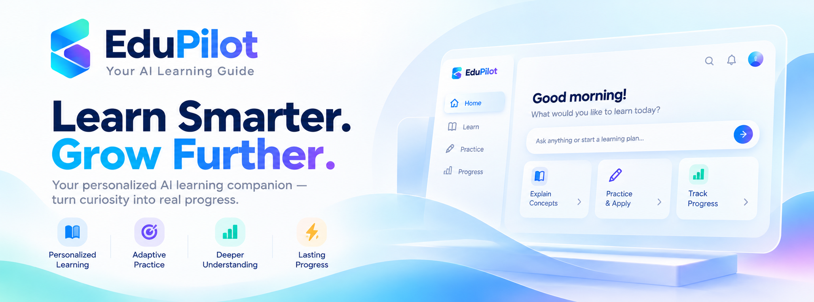

<h1 align="center">EduPilot · Your AI Learning Companion</h1>

<strong>Turn your materials into an AI course—with lessons, practice and a companion to learn alongside you.</strong>

Import Chinese or English materials and move naturally between explanations, practice and review. Native desktop app for Windows / macOS · English and Chinese · Try the built-in demo without a key

  
  
  
  

<a href="#features">Highlights</a> · <a href="#workspace">See the workspace</a> · <a href="#download">Download</a> · <a href="#demo">Learning demo</a> · <a href="#api-keys">Connect a model</a> · <a href="#faq">FAQ</a>

## Your materials. Your course. Your learning journey.

Slides, textbooks and notes contain plenty of knowledge. Studying them on your own often leaves harder questions: Where should I start? What does this passage mean? Have I really understood it?

EduPilot brings your materials, explanations, practice and study history into one workspace. Import a textbook and work through its chapters. Ask when something is unclear, practise what you have learned, then return to consolidate it. Follow the course step by step or explore a question of your own.

Preview questions help you build a map of the topic. Analogies, examples and follow-up questions deepen your understanding, while review checks and mistakes reveal what needs more work. Your materials ground the lessons; progress and long-term memory give your next session a place to continue.

**For independent learners, students revising a course, anyone building a personal study library, and people learning Python through practice.**

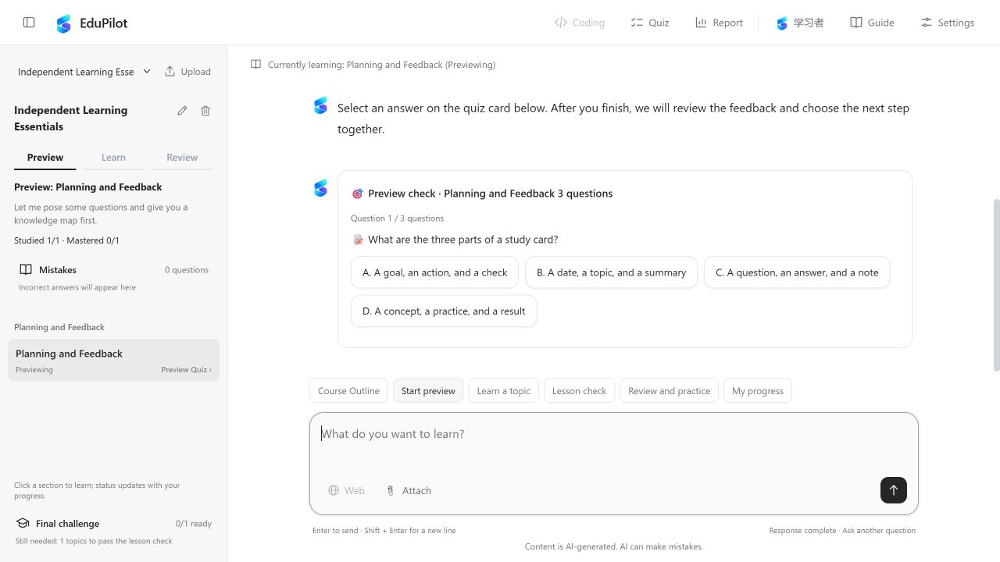

Choose a course and topic on the left, then ask, learn and practise with your companion on the right. The screenshot shows a course created from imported materials; the built-in Python demo is another way to explore the full learning flow.

See the built-in course and focused conversation layout

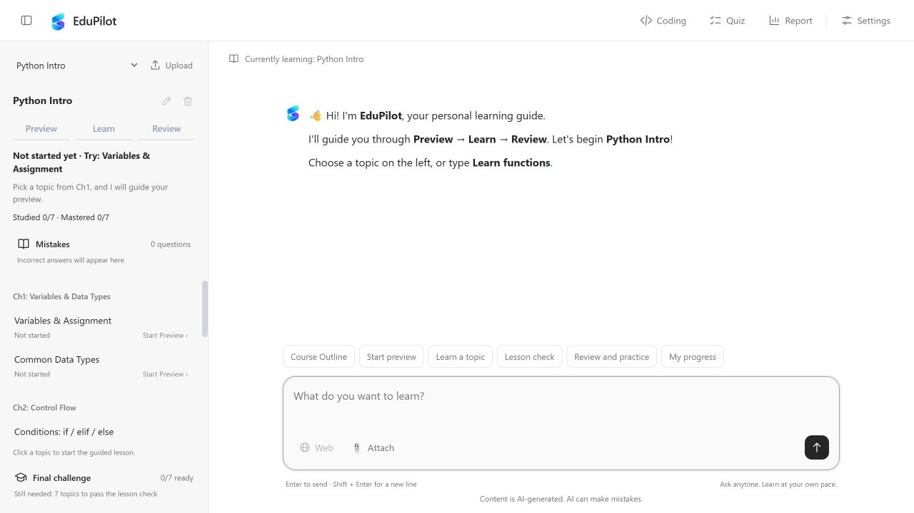

Collapse the sidebar to give explanations and follow-up questions more room.

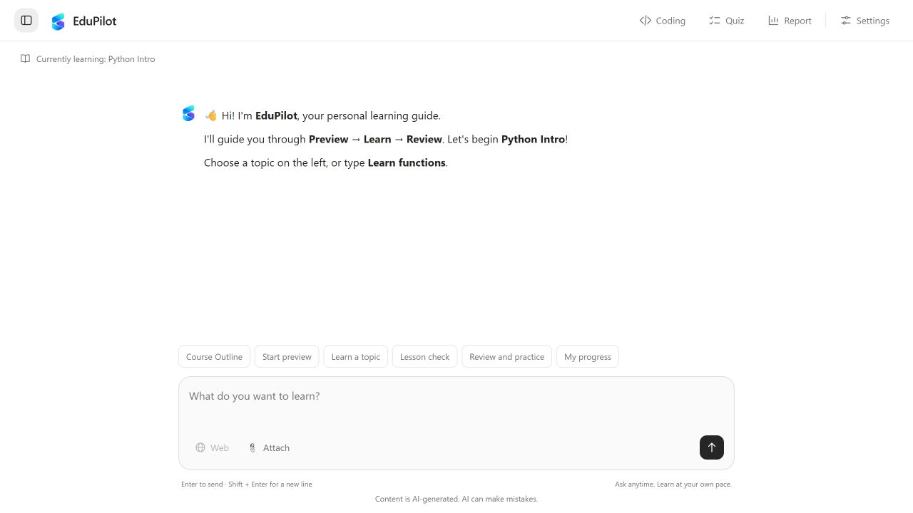

## Three steps to your first lesson

Download the native desktop app and start learning from its icon, with no server to manage or separate Node.js / Python installation. The app uses its own window, stays in the tray when closed, and automatically attempts to recover a failed backend.

| Your computer | Download |
| --- | --- |
| Windows x64 | [Download Setup.exe](https://github.com/2092372408-pixel/EduPilot/releases/download/v1.1.6/EduPilot-1.1.6-Windows-x64-Setup.exe) |
| Mac · Apple Silicon (M-series chips) | [Download Apple Silicon DMG](https://github.com/2092372408-pixel/EduPilot/releases/download/v1.1.6/EduPilot-1.1.6-macOS-arm64.dmg) |
| Mac · Intel | [Download Intel DMG](https://github.com/2092372408-pixel/EduPilot/releases/download/v1.1.6/EduPilot-1.1.6-macOS-x64.dmg) |

1. **Download** the installer for your computer. Choose Apple Silicon for an M-series Mac.
2. **Double-click to install**: run `Setup.exe` on Windows and follow the prompts. On macOS, open the `.dmg` and drag EduPilot into Applications.
3. **Try the demo, then bring your materials**: explore the built-in Python course without a key. Connect a model in Settings when you are ready to turn your own materials into a course.

Next time, open **EduPilot** from the Windows desktop or Mac Launchpad. Closing the window hides it to the tray (the menu bar on Mac) while the backend keeps running. Select **Quit EduPilot** from the menu to exit completely. Your study records stay on your computer for your next session.

A tour points to real controls on your first visit, introducing courses, uploads, questions, mistakes and reports. Skip whenever you like, or select **Guide** at the top to replay it. Current installers are unsigned, and Mac packages are not notarized; your OS may warn or block opening them. Check the attachments and SHA-256 checksums on the [Release page](https://github.com/2092372408-pixel/EduPilot/releases/tag/v1.1.6). Older browser-based packages remain available in [v1.1.4](https://github.com/2092372408-pixel/EduPilot/releases/tag/v1.1.4).

A guide for your first visit

The tour highlights real buttons, with arrows and nearby explanations to help you take the first step. Skip or replay it whenever you like.

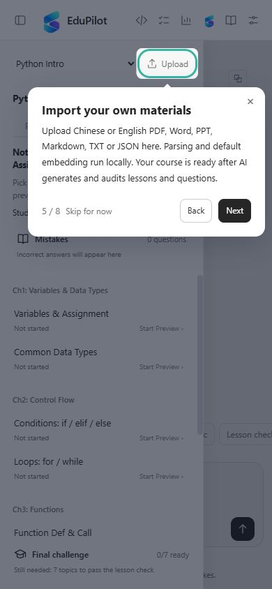

The native installer includes the application runtime, Python and document conversion dependencies. Semantic search downloads its model on first use; online answers still require your own model service configuration. See the [desktop launch and exit guide (Chinese)](docs/桌面启动与退出说明.md) for more details.

## From your materials to a complete study session

Import materials → Create a course → Preview check → Learn and practise → View your report. The animation below shows key steps from real interactions.

Watch the learning flow in the actual interface

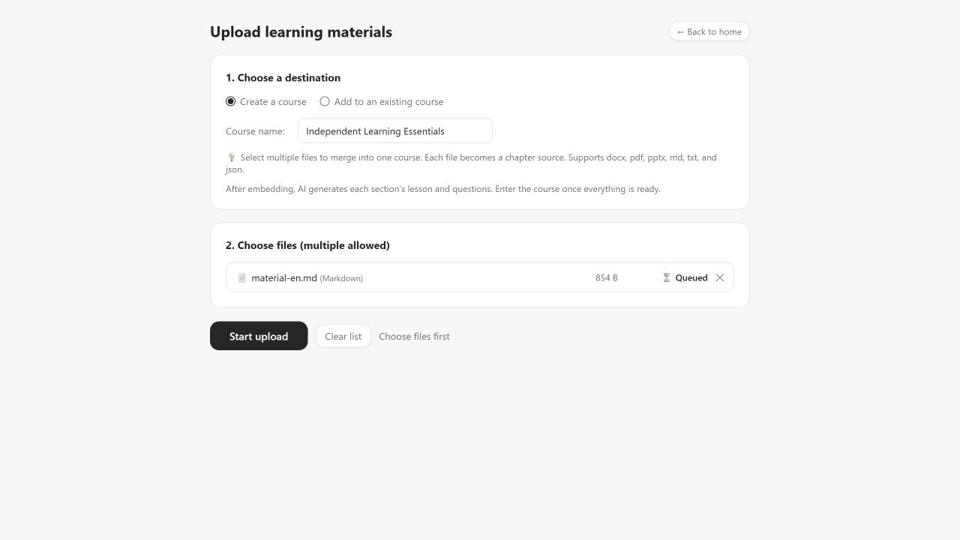

## Six ways to keep learning moving

### 1. Turn a textbook into a course you can work through

Import Chinese or English PDF, Word (.docx), PowerPoint (.pptx), Markdown, TXT or JSON files. EduPilot organises the chapters and generates topic lessons, examples, common pitfalls and multiple-choice practice. Once ready, your course follows the same learning flow as the built-in demo.

Follow the process from your materials to a ready-to-study course:

- **Keep the chapter structure**: existing headings come first, with support for headings such as “第一章”, “Chapter 1” and “1.1”. Retrieval passages respect detected chapter and section boundaries and retain their sources.
- **See processing progress**: follow parsing, chapter splitting, retrieval indexing, lesson and question generation, and saving. Parsing shows elapsed time; embedding and course generation show actual completion counts.
- **Generate from your source**: lessons and questions use the materials as evidence, followed by a separate check against the source before the course becomes available.
- **Grow your course over time**: add materials and reuse unchanged content, embeddings and lessons. A failed update preserves the previous usable course.

See material import and processing progress

Select **Upload** in the sidebar, create a course or add to an existing one, then choose your materials and start processing. When ready, return to the workspace and select the generated chapters and topics.

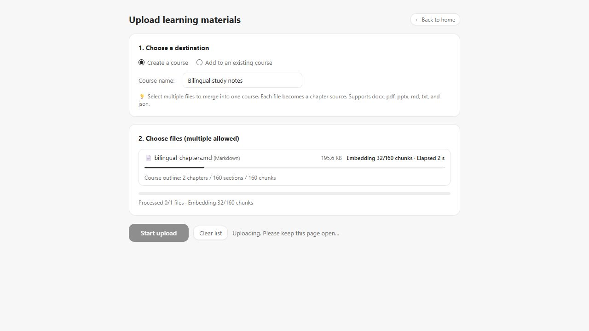

### 2. Preview → Learn → Review, with a next step throughout

Use a preview check to discover what is unfamiliar. Build understanding through explanations, get feedback through practice, then revisit the topic to consolidate it. Ask for another example or explain where you got stuck without leaving the learning flow.

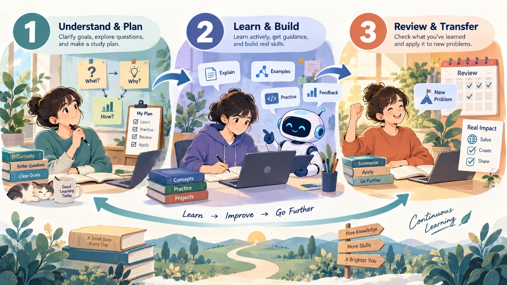

| Stage | How you learn | How you move forward |
| --- | --- | --- |
| Preview | Explore the topic map, answer guiding questions and complete a preview check | Finish the check to enter Learn; mistakes are welcome during preview |
| Learn | Work through explanations, examples and common pitfalls, then practise | Answer every question in the lesson check correctly to enter Review |
| Review | Revisit ideas and weak spots, then complete a review test | Answer every review question correctly to record mastery and schedule future review |

Each topic has its own learning stage. Content you have studied and topics you have passed are shown separately, helping you focus on what still needs practice.

Learn and practise in the conversation

Answer question cards directly in the conversation, then continue with feedback and explanations. Multiple-choice answers are checked against the question bank on the server. Formal stage checks advance progress; extra practice and retrying mistakes help consolidate understanding.

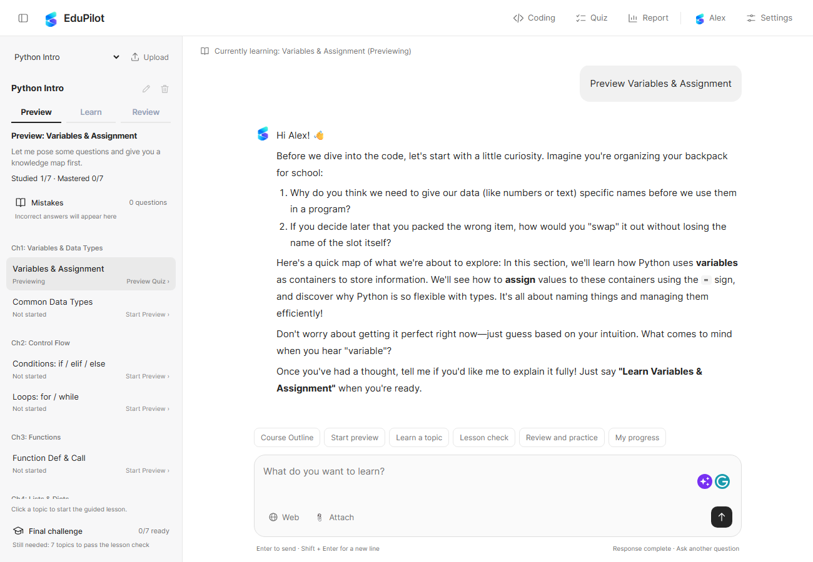

### 3. Keep your goals in view—and pick up where you left off

Tell your companion about your goals, starting point and preferences: “I'm new to Python; everyday examples help me.” Useful information from your study sessions can inform later explanations, so you do not have to introduce yourself each time.

Course progress, conversations and practice history stay on your computer. Goals and preferences can carry across courses, while each course keeps its own progress and difficulties. Come back to the course you were studying, and let your questions and practice build into a continuous learning journey.

How your companion connects study sessions

Your current goals and course progress inform explanations. Earlier conversations remain searchable, and useful long-term information is retrieved when relevant. Older dialogue is summarised, and model context has a length limit to manage the input volume and cost of longer conversations.

Long-term memory focuses on explicit study goals, stable preferences and recurring difficulties. Tell your companion when a goal or preference changes so later sessions can adapt.

### 4. Use mistakes, review and reports to focus your effort

Incorrect answers go into your mistake notebook, where you can revisit your answer, read the correct answer and explanation, and try again. Your learning report brings course progress, pending checks and review plans together to help you choose what comes next.

The workspace, notebook and report connect the same learning journey: find a pending check in your report and return to the course, or revisit a topic that needs reinforcement. After meeting the completion requirements in the built-in Python course, take a comprehensive assessment and put the topics together.

See the mistake notebook and learning report

Open **Mistakes** in the sidebar to revisit answers and retry a question.

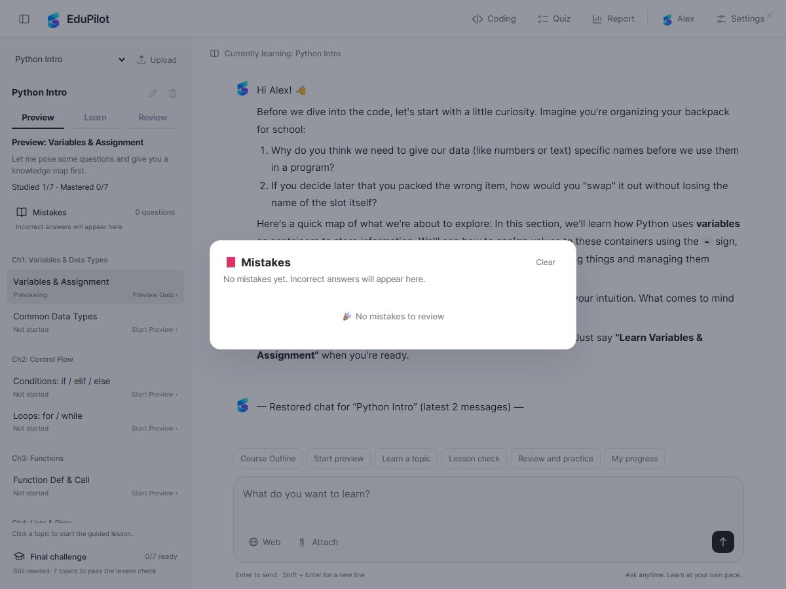

Open **Report** at the top to see study coverage, verified mastery, next steps and review plans.

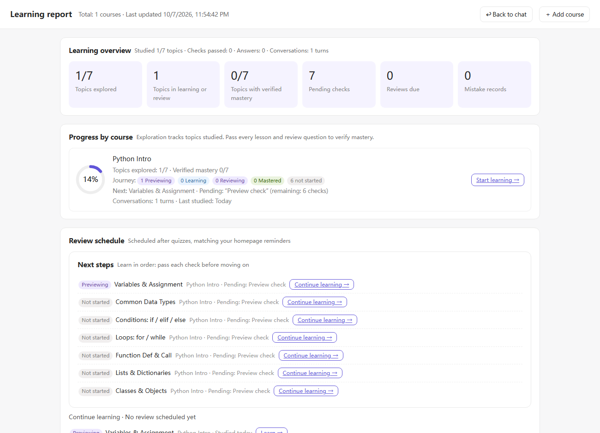

### 5. Follow a course, ask a question, or try it yourself

Dedicated companion roles support planning, preview, learning and review. A general education companion helps with questions beyond the course, offering explanations, examples and study advice. Follow the chapters or pause to explore a question that interests you.

- **Ask with your materials**: attach an image or document to discuss it alongside your question. Choose an image-capable model for pictures.
- **Research when needed**: use the web search toggle beside the input box to find additional learning material. Search needs a separate Tavily key.
- **Practise Python**: write, run and submit code for feedback. The practice assistant can use the current task and execution results to offer hints.

See attachments, multiple-choice practice and Python coding

Add an attachment beside the input box and ask about the material.

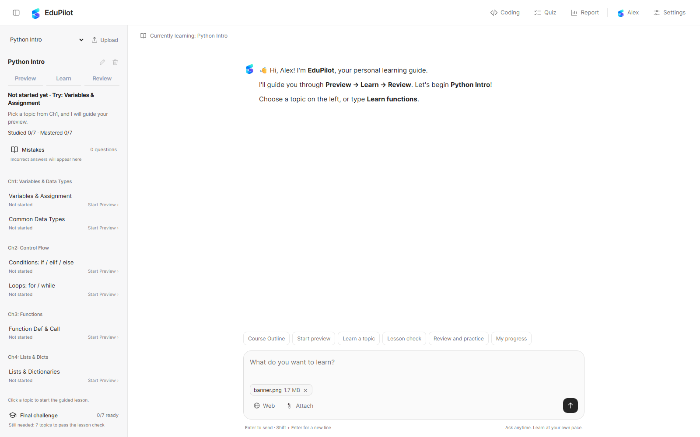

The built-in Python course has separate multiple-choice and coding workspaces. Imported courses provide their generated multiple-choice questions in the learning conversation.

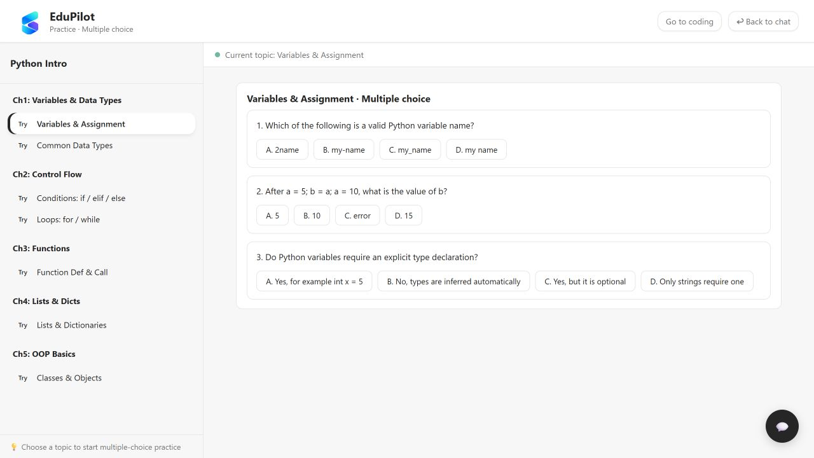

Run code to inspect its output, then submit for grading feedback. Open the practice assistant when you need a hint.

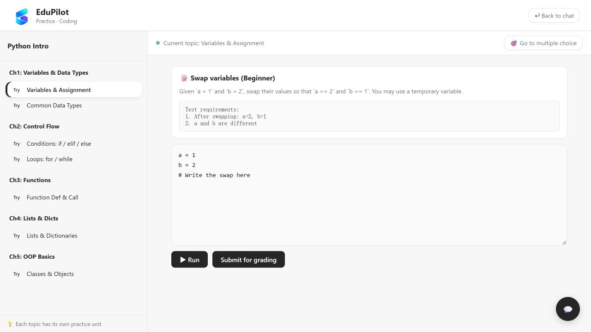

### 6. Learn on your computer, with your choice of model and language

Available for Windows and macOS. Double-click the icon to open your workspace. The native app stays in the tray when its window closes; select Quit EduPilot to stop it. Browser-based compatibility packages stop after their last page closes. Courses, conversations, mistakes and study records stay on your computer.

Switch between English and Chinese, adjust the text size or collapse the sidebar. Connect DeepSeek, Qwen, OpenAI, GLM, Kimi or another compatible service, and choose the model that suits how you learn.

Documents are parsed locally. When you use an online model or web search, relevant questions, material excerpts or attachments are sent to your selected provider. Choose which capabilities you want to use.

See language and display settings

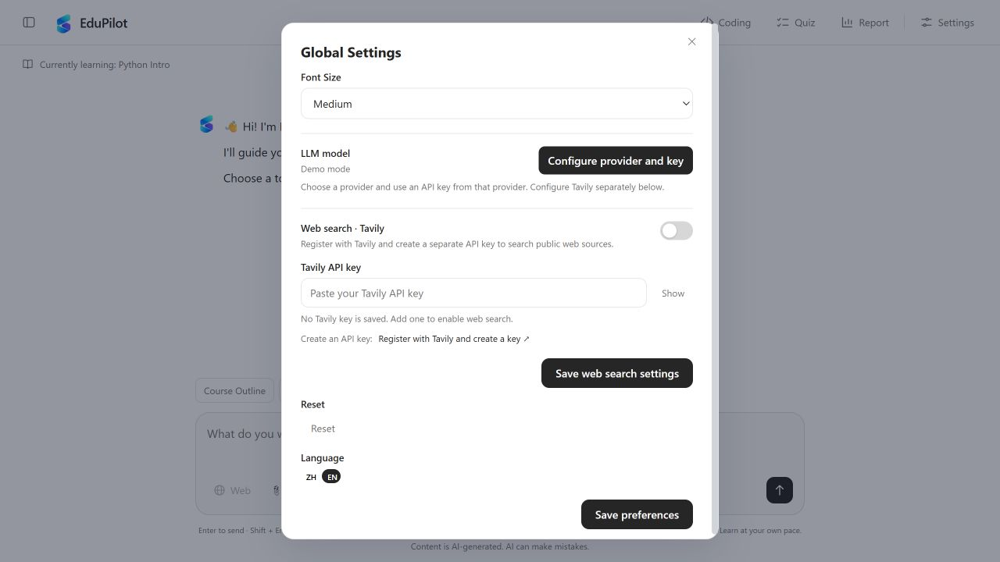

## Connect your preferred model

Open **Settings → LLM model → Configure provider and key**. Choose a provider, enter your API key, select a model and save. Open-ended answers and generating lessons and questions from your materials use this model and are billed by its provider.

Connect DeepSeek, Qwen, OpenAI, GLM, Kimi or another compatible service. For web research, add a [Tavily key](https://app.tavily.com/home) in **Settings → Web search · Tavily**, then turn search on when needed.

Use **Test connection** before saving. If the model you need is missing from the list, enter its provider-supplied custom Model ID. Before sending pictures, select a model that supports image input and test its image capability.

See model configuration

Choose a provider, check model capability labels and enter your key in the interface, without editing configuration files.

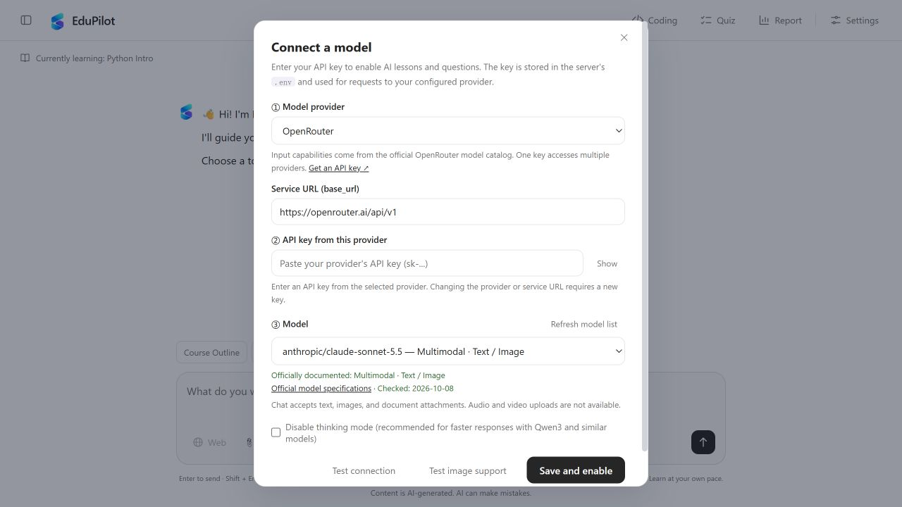

Official API key pages

| Provider | Official page |
| --- | --- |
| DeepSeek | [Create an API key](https://platform.deepseek.com/api_keys) |
| Alibaba Cloud Model Studio · Qwen | [Console](https://bailian.console.aliyun.com/) |
| OpenAI | [Create an API key](https://platform.openai.com/api-keys) |
| Zhipu · GLM | [Create an API key](https://open.bigmodel.cn/usercenter/apikeys) |
| Moonshot · Kimi | [Create an API key](https://platform.kimi.com/console/api-keys) |
| SiliconFlow | [Create an API key](https://cloud.siliconflow.cn/account/ak) |
| Volcengine Ark · Doubao | [Console](https://console.volcengine.com/ark) |
| OpenRouter | [Create an API key](https://openrouter.ai/keys) |

## A few things you might want to know

**Can I try it without an API key?**

Yes. The built-in Python demo needs no key. Real open-ended answers and turning your own materials into courses require a model connection. Web search uses a separate Tavily key.

**Does it support Chinese and English materials?**

Yes, in both content and interface. Use PDFs with extractable text; scanned pages need to be converted to text first.

**Why did a correct answer not mark a topic as mastered?**

Each stage has its own check. Finishing the preview check unlocks Learn; a fully correct lesson check unlocks Review; a fully correct review test records mastery. Extra practice and retrying mistakes do not replace formal stage checks.

**Where are my materials and study records stored?**

Materials are parsed on your computer, where courses, conversations and study records are stored. When you use an online model or web search, relevant questions, textbook excerpts or attachments are sent to your selected provider.

**Do I need to install anything else?**

The native installer includes the application runtime, Python and document conversion dependencies. Local semantic search downloads an embedding model on first use and falls back to keyword search if unavailable. Older browser-based packages still need a separate Python installation for coding practice.

**How long does importing take? Can I close the page?**

Time depends on the material, number of topics, your computer and the model's response speed. Document parsing is local; generating and checking lessons and questions uses your selected model. The page shows the current stage and actual completion counts. Wait until the course is ready before closing it. Follow the retry prompt if processing fails; a failed update preserves the previous usable course.

**Does closing the page quit the app? What about refreshing?**

Closing the native window hides it to the tray while the backend keeps running. Click the tray icon or launch the app again to return; select Quit EduPilot to exit completely. Older browser-based packages stop about 15 seconds after their last page closes. Refreshing does not stop the backend.

**Will upgrading keep my learning history?**

Native updates preserve the same system user's settings, courses and learning records. Quit the app completely before installing an update. Data from older script packages is not migrated automatically; keep the original folder as a backup.

## Why we built EduPilot

We want education to be more scientific, more structured, and more firmly in the learner's hands. A clear process should not force everyone into the same template. It should make goals, exploration, feedback, and review visible. Learners should not have to wait for a teacher to arrange every next step; they should be able to ask, try, reflect, and choose where to go next.

Learning is also a lifelong, continuous path rather than a staircase of disconnected levels. What you understood yesterday becomes today's starting point, while today's questions leave useful clues for tomorrow. EduPilot uses AI to preserve that continuity, so every question, exercise, mistake, and breakthrough can support what comes next.

As AI develops rapidly, the speed and efficiency of learning matter more than ever. We want to help more people learn efficiently and continuously without losing the freedom to explore, so they can learn what they truly want to learn and then do what they truly want to do.

> **Learn what you want, then do what you want. Every step deserves to be recorded.**

## Help make learning feel better

Have a suggestion, a course you would like to study or a problem to report? Tell us through [GitHub Issues](https://github.com/2092372408-pixel/EduPilot/issues) or [email](mailto:qiuyanzihan2004@gmail.com).

© 2026 **Qiu Yanzihan** · For personal and noncommercial use, see the [license](LICENSE). Contact the author for commercial collaboration. Third-party terms are listed in [Third-Party Notices](THIRD_PARTY_NOTICES.md).
