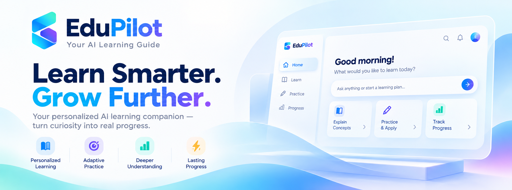
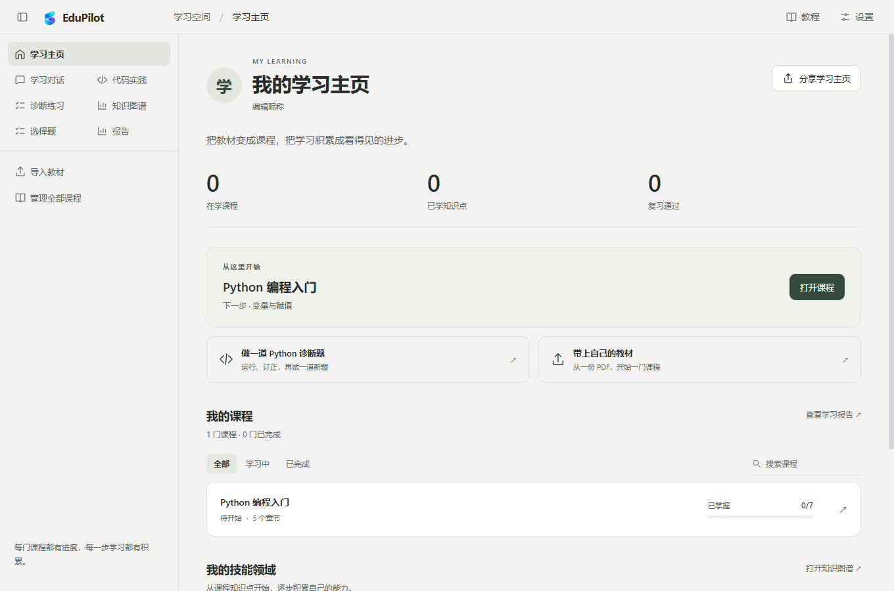
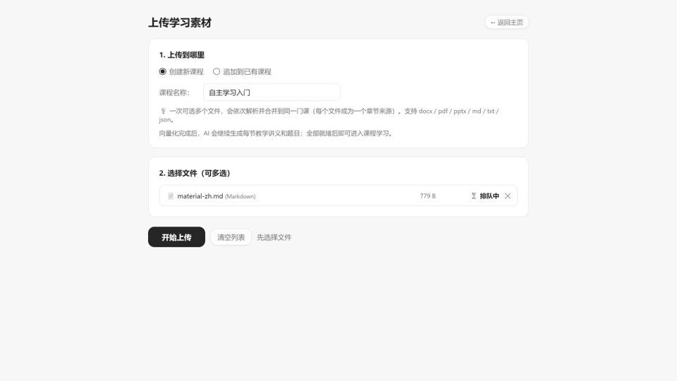

<p align="right"><strong>简体中文</strong> | <a href="README.md">English</a></p>

<p align="center"></p>

<h1 align="center">EduPilot · AI 学习向导</h1>

<p align="center"><strong>把教材变成课程，把学习积累成看得见的进步。</strong></p>

<p align="center">Windows / macOS 桌面应用 · 中英文界面 · 自选 AI 模型</p>

EduPilot 把 **教材、练习和学习进度** 放在同一个 AI 工作台：导入资料，按章节学习；通过练习和复习检验理解，再用知识图谱连接所学。个人学习主页汇总每门课的进度与技能积累，下次打开接着学，也能把成果分享给朋友。

**[先试一道内置 Python 诊断题，再带上自己的教材开始。](#quick-start)**

<p align="center"><a href="#download">下载安装</a> · <a href="#features">核心能力</a> · <a href="#quick-start">三步上手</a> · <a href="#workspace">学习演示</a> · <a href="#docs">文档</a></p>

<a id="download"></a>

## 下载 v2.1.0

| 平台 | 安装包 |
| --- | --- |
| Windows x64 | [下载 Setup.exe](https://github.com/2092372408-pixel/EduPilot/releases/download/v2.1.0/EduPilot-2.1.0-Windows-x64-Setup.exe) |
| macOS · Apple Silicon（M 系列） | [下载 Apple Silicon DMG](https://github.com/2092372408-pixel/EduPilot/releases/download/v2.1.0/EduPilot-2.1.0-macOS-arm64.dmg) |
| macOS · Intel | [下载 Intel DMG](https://github.com/2092372408-pixel/EduPilot/releases/download/v2.1.0/EduPilot-2.1.0-macOS-x64.dmg) |

安装包自带应用运行环境、Python 和文档解析依赖。安装与升级说明见 [桌面指南](docs/桌面启动与退出说明.md)，更多下载见 [Release 页面](https://github.com/2092372408-pixel/EduPilot/releases/tag/v2.1.0)。

<a id="features"></a>

## 核心能力

### 教材变课程

导入中英文 PDF、Word、PowerPoint、Markdown、TXT 或 JSON，按章节组织学习内容。围绕原文查看讲解、追问细节、完成配套选择题，让学习沿着自己的教材展开。

### 预习 → 学习 → 复习

多角色学伴配合规划、讲解与练习，每个知识点都有自己的学习进度。错题本、复习安排和学习报告帮助你找到下一步，学习目标与偏好也能延续到后续对话。

### Python 诊断练习

围绕内置 Python 课程的分支判断、循环求和、函数返回三个主题，运行代码并查看失败输入、预期结果与实际输出。按需获取分级提示，订正后再试一道新变式，分别记录订正和新题首次作答的结果。

### 个人知识图谱

连接课程、章节和知识点，查看内容来源与学习记录。搜索感兴趣的主题，添加笔记、确认跨课程关联，把分散的内容整理成自己的知识网络。

### 个人学习主页

集中查看各门课的进度、已通过复习的知识点和正在积累的技能领域。回到课程继续学习，或选取想展示的课程，生成带项目地址与二维码的学习名片，保存图片或分享给朋友。[查看学习名片 →](docs/screenshots/learning-card-zh.png)

### 课程管理

搜索、打开、改名或单独删除上传课程，也可以追加和更新资料。在一个工作台维护自己的课程库，随时回到之前的学习进度与对话。

<a id="quick-start"></a>

## 三步上手

1. **安装并打开**：Windows 运行 `Setup.exe`；macOS 打开 DMG，将 EduPilot 拖入 Applications。
2. **先做一道题**：打开 **诊断练习**，从内置 Python 课程的分支、循环或函数开始，提交代码、查看反馈，再挑战一道新变式。这一步无需 API Key。
3. **学自己的课程**：在 **设置 → LLM 模型** 中接入 DeepSeek、Qwen、OpenAI、GLM、Kimi 等服务或兼容接口，测试连接后保存；从主页点击 **导入教材**，按章节开始学习。

图谱整理与内置诊断练习的发题、判分、分级提示可以直接使用。AI 对话和教材内容生成使用所选模型服务；相关问题、教材片段或附件会发送给该服务商。

点击顶部 **教程** 可随时查看界面引导。完整操作说明见 [学习指南](docs/学生端说明书.md)。

<a id="workspace"></a>

## 你的学习主页

打开即可看到课程进度，从上次的位置继续。想分享时，生成一张自己的学习名片。



<details>
<summary>观看教材学习演示</summary>

导入资料 → 生成课程 → 预习检测 → 学习与练习 → 查看报告。



</details>

<a id="source"></a>

<details>
<summary>开发者：从源码启动</summary>

准备 Node.js 22+ 和 Python 3，在终端执行：

```bash
git clone https://github.com/2092372408-pixel/EduPilot.git
cd EduPilot
npm ci --omit=dev
npm start
```

打开 [http://127.0.0.1:8787](http://127.0.0.1:8787)，在设置中接入模型。教材解析和本地语义检索还需安装 [Python 依赖](requirements-docker.txt)。

原生桌面开发与打包步骤见 [开发说明](docs/桌面启动与退出说明.md#源码与桌面开发)。

</details>

<a id="docs"></a>

## 文档与交流

- [学习指南](docs/学生端说明书.md)：功能入口、练习、图谱与日常使用。
- [桌面指南](docs/桌面启动与退出说明.md)：安装、启动退出、数据备份与升级。
- [下载与存储指引](docs/安装与数据位置指南.md)：选择安装包、程序安装位置、学习数据位置与迁移注意事项。
- [v2.1.0 更新说明](docs/releases/v2.1.0.md)。
- [GitHub Issues](https://github.com/2092372408-pixel/EduPilot/issues)：反馈问题与建议。
- [贡献指南](CONTRIBUTING.md)：开发环境、协作流程与 PR 说明。
- [开发路线图](ROADMAP.md)：了解当前方向并参与功能讨论。
- [获取帮助](SUPPORT.md)：安装、使用与问题反馈。
- [社区行为准则](CODE_OF_CONDUCT.md) 与 [安全问题报告](SECURITY.md)。

> 学自己想学的，做自己想做的。

© 2026 **Qiu Yanzihan** · 个人与非商业使用请参阅 [使用许可](LICENSE) · [第三方许可说明](THIRD_PARTY_NOTICES.md)
